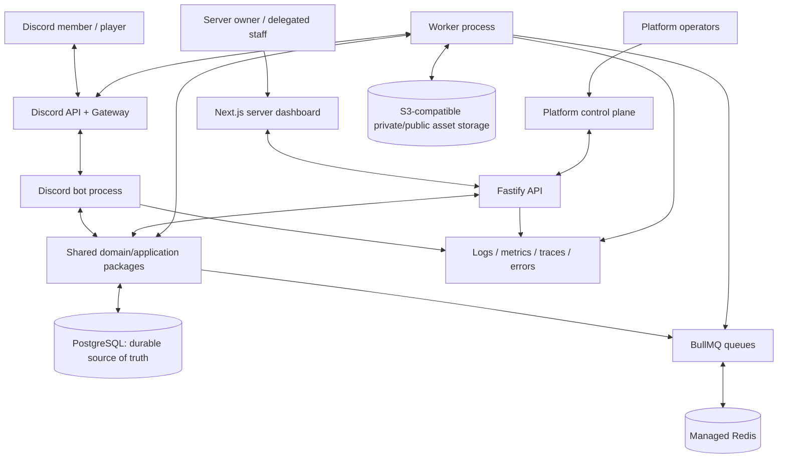

# System Architecture

**Decision status:** baseline architecture; implement in a modular monorepo and split runtime processes where operationally necessary. Avoid early microservices.

## 1. System context



The bot, API and workers may deploy separately from the same monorepo. The dashboard is a separate deployable app. Shared domain logic, schemas and contracts must not depend on a specific hosting vendor.

## 2. Approved baseline stack

- **Runtime:** Node.js LTS + TypeScript strict mode. Pin Node/pnpm through repository toolchain files and CI.
- **Monorepo:** pnpm workspaces and Turborepo for shared builds, caching and task orchestration.
- **Bot:** discord.js; slash commands, buttons, select menus, modals, user/message context menu commands where useful; use Gateway intents only when feature requirements justify them.
- **Dashboard:** Next.js App Router, React and Tailwind CSS. Use server components for appropriate read-heavy/rendered routes and client components for interactive forms/tables only when needed.
- **Component system:** shadcn/ui-style owned components with accessible Radix primitives (or another chosen primitive library only through an ADR). Do not let the visual system emerge from per-screen improvisation.
- **API:** Fastify with shared Zod contracts via a maintained Fastify/Zod type-provider adapter, typed handlers, request validation and response serialization. Pin compatible versions and test the adapter during upgrades. Domain authorization is independent of route/UI logic.
- **Data:** PostgreSQL, Drizzle ORM and reviewed, version-controlled SQL migrations. Do not rely on production schema push as the release mechanism.
- **Async jobs:** Redis + BullMQ; durable job intent and business state remain in PostgreSQL, with an outbox/reconciliation strategy for work that must not be lost between a database write and queue publish.
- **Client data and forms:** TanStack Query where client cache/invalidation materially helps; React Hook Form for complex data entry. Validation rules shared or generated from canonical domain contracts to avoid client/server drift.
- **Storage:** S3-compatible object store; short-lived signed URLs for private evidence; upload size/type limits and malware/content policy appropriate to the files.
- **Test:** Vitest, API integration tests with disposable PostgreSQL/Redis, Playwright for browser workflows, contract tests, and controlled staging guild tests.
- **Observability:** Pino structured logs; OpenTelemetry-compatible traces/metrics where supported; error reporting; redaction at source.
- **Quality:** ESLint, Prettier, type checking, secret scanning, dependency audit, migration checks and CI required status checks.

Version-sensitive details must be checked against current official documentation before implementation; do not treat this baseline as a license to use latest major versions blindly.

## 3. Monorepo layout

```text
apps/
  bot/                  # Gateway client, commands, Discord event adapters
  api/                  # Fastify routes, auth/session endpoints, webhook receivers
  web/                  # Server owner/staff dashboard
  control-plane/        # Platform operator console; may share the web app shell but separate route policies
  worker/               # BullMQ workers and scheduled/reconciliation tasks
packages/
  contracts/            # Shared Zod schemas, API DTOs, event payloads
  domain/               # Pure domain rules and state transitions
  application/          # Use cases/orchestration; authz and transactions
  database/             # Drizzle schema, repositories, migrations, transaction helpers
  authorization/        # Permission evaluation and policy helpers
  discord-adapter/      # Discord client abstractions, rate-limit-aware sends
  queue/                # Job names, payload schemas, retry policies and enqueue helpers
  ui/                   # Reusable web components and design tokens
  config/               # Validated environment/configuration loading
  observability/        # Logger, metrics, traces, correlation IDs and redaction
  test-utils/           # Fixtures, factories, fakes and integration helpers
docs/
  decisions/            # ADRs
  runbooks/             # Operator procedures
  threat-models/        # Updated threat analysis
.agents/skills/         # Project-specific agent instructions
```

Do not create empty packages before use; this is the target boundary map, not a requirement to make every folder on day one. Keep imports one-directional: domain logic does not import Discord, Fastify, React or persistence clients.

## 4. Dependency direction

```text
Adapters (Discord / HTTP / queue / UI)
            ↓
Application use cases + authorization
            ↓
Domain model + domain policies
            ↓
Ports/interfaces (repository, clock, job publisher, Discord sender, audit writer)
            ↑
Infrastructure adapters (Postgres, Redis, Discord API, object storage)
```

Domain code is deterministic where practical. Interaction adapters parse and validate external input; application services establish identity, tenant context and authorization; domain functions decide valid transitions; repositories persist inside transactions; an event/outbox publisher starts side effects after committed state.

## 5. Runtime responsibilities

### Bot process

- Owns the long-lived Discord Gateway connection and interaction/event adapters.
- Acknowledges interactions within Discord timing rules; defer long operations and return a clear follow-up.
- Validates guild context and maps interaction identity to server-scoped actor context.
- Does not implement business policy independently of shared application use cases.
- Rehydrates persistent components and scheduled business work from durable IDs/state after restart.
- Uses per-guild rate limiting/backpressure and Discord API response semantics; no blind retry loops.

### API process

- Handles OAuth callback, session lifecycle, dashboard reads/writes, configuration APIs and platform-console endpoints.
- Requires an authenticated actor and verified current permission for every protected operation.
- Never trusts `guildId`, `actorRole`, `isOwner` or tenant information from a client without checking it against durable records and/or authoritative Discord data.
- Applies request schemas and response schemas, consistent error envelopes, request IDs and redaction.

### Worker process

- Handles scheduled publications, reminder delivery, registration deadlines, event transitions, match reminders, exports, cleanup/retention, reconciliation and retryable Discord actions.
- Jobs are versioned, validated, idempotent and bounded by timeout/retry/backoff policies.
- A worker failure is observable and does not silently erase business intent.
- Uses lease/concurrency controls for jobs that must run once logically.

### Dashboard

- Provides configuration and domain workflows; it is never the security boundary by itself.
- Uses the API/application layer for mutations; no direct database access from browser code.
- Has explicit loading, empty, error, retry, permission denied, stale data and partial-success UI states.
- Does not hold bot tokens or provider secrets in browser storage.

## 6. Integration and side-effect pattern

For business writes that trigger external effects (publish an announcement, send a reminder, close a registration, post a result):

1. Authenticate and authorize actor, resource and action.
2. Validate input and verify current business state/version.
3. Commit the state change and an outbox event in one PostgreSQL transaction where feasible.
4. Outbox dispatcher queues a versioned job/event.
5. Worker checks idempotency key and current desired state.
6. Worker calls Discord/provider with bounded retries and respects retry-after/rate limits.
7. Record the external outcome, provider message ID where applicable, attempts and a durable final state.
8. Expose success, pending, partial or failed status in the dashboard/bot.

This avoids the dual-write gap where a database transaction commits but publishing a queue job fails. For simpler operations, use the same durability principles proportional to risk.

## 7. Action-Safety Policy Boundary

The `ActionPolicyEngine` in `@nexus/authorization` forms the single, centralized, transport-independent enforcement gate for state mutations across all entry points:

```text
  [Web Dashboard / REST API]      [Discord Slash Commands]
                 ↘                         ↙
             [Central ActionPolicyEngine]
              - Capability & grant checks
              - Discord permission manifest check (Administrator or Granular)
              - Role hierarchy & protected target check
              - Global & per-guild emergency kill-switches
              - Hard bulk safety ceilings (purge/batch limits)
              - Single-use confirmation tokens for destructive actions
              - Mass mention (@everyone / @here) suppression
                         ↓
             [Application Workflows & Outbox]
                         ↓
              [PostgreSQL Transaction & Event]
                         ↓
              [Transactional Outbox Workers]
```

### Inviolable Invariants:

1. **Administrator Invariant:** The presence of the Discord `ADMINISTRATOR` permission (`0x8`) satisfies external Discord transport permission requirements, but **NEVER** bypasses internal Nexus authorization, role hierarchy, bulk limits, emergency stops, or confirmation requirements.
2. **Fail-Closed Policy:** Any indeterminate evaluation state, missing actor grant, or emergency stop triggers an immediate rejection.
3. **Transport Independence:** Future Discord command adapters (Milestone 4) and outbox workers MUST invoke the same `evaluateActionPolicy` / application workflows rather than implementing custom Discord permission checks.

## 8. Tenant model

The unit of configuration and isolation is the Discord guild. All tenant-owned records are linked to a `guild_id` or a tenant-scoped parent; tenant repository methods require a `TenantContext` rather than accepting naked IDs. Unique constraints, foreign keys and queries include tenant scope when relevant. Add PostgreSQL Row-Level Security only as defense in depth after connection/context handling is safely designed; never treat RLS as a substitute for application authorization and tests.

Global shared resources (built-in game templates, default announcement templates) are explicitly global and read-only for tenants unless a tenant clones them. A clone receives its own IDs and version chain. Global operators access tenant data only via approved, audited support flows.

## 9. Caching and consistency

- PostgreSQL is authoritative for configuration, authorization grants, registrations, matches, audit and workflow state.
- Redis is disposable cache and queue infrastructure; correctness must survive eviction/restart.
- Authorization decisions may be cached only with a documented TTL/invalidation strategy and must fail closed for privileged operations if freshness cannot be established.
- Never cache one tenant's response under a key that can collide with another tenant. Include tenant, user, resource and policy version in cache identity where relevant.
- Queue delivery is generally at-least-once. Consumers must be idempotent; never assume exactly-once distributed execution.
- Read-after-write UI behavior is defined for critical flows, especially registration, roster mutation and match result submission.

## 10. Scaling path

**Pilot:** one API instance, one bot instance, one worker deployment with concurrency controls, managed PostgreSQL, managed Redis and object store.  
**Growth:** independent API replicas; separate worker pools by queue class; bot sharding only when Discord guild-count/Gateway requirements and metrics justify it; read/query optimization, connection pooling and cache tuning.  
**Large scale:** partition queue workloads, isolate high-volume tenants where measured needs justify it, improve database capacity/replicas and consider domain service extraction only when deploy/ownership/load bottlenecks require it.

Never introduce sharding or microservices as marketing checkboxes. Track guild count, event rate, queue wait time, Discord API errors, database pool saturation, latency and memory before scaling.

## 11. Architectural quality gates

- No domain policy is implemented only in React or only inside a Discord command.
- No cross-tenant query can execute without tenant context.
- No business-critical side effect relies solely on in-memory timers.
- No API returns ORM records without explicit DTO/response schema filtering.
- No worker retries an irreversible action without checking idempotency/current state.
- No secret is required at build time for a public dashboard bundle.
- Architecture changes that affect state, authorization, data, deployment or integrations require an ADR and tests.
