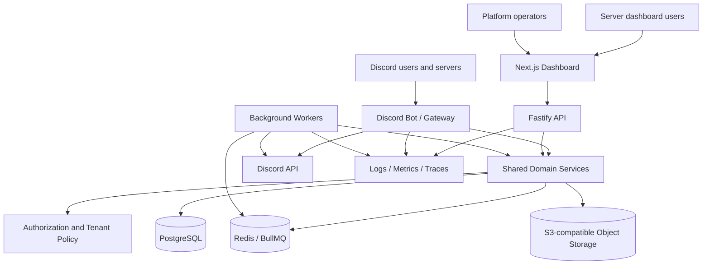

# Nexus — Gaming & Esports Discord Platform

## Product Requirements, Technical Architecture, Security Model, and End-to-End Delivery Plan

| Field                   | Value                                                                                                                                                  |
| ----------------------- | ------------------------------------------------------------------------------------------------------------------------------------------------------ |
| Document                | `REQUIREMENTS.md`                                                                                                                                      |
| Version                 | 1.1                                                                                                                                                    |
| Date                    | 2026-10-22                                                                                                                                             |
| Status                  | Baseline specification for implementation planning; companion specs, quality gates and tailored agent skills are maintained in this specification pack |
| Working product name    | **Nexus** (inherited from supplied audit; brand/trademark review is still required before public launch)                                               |
| Proposed repository     | `gaming-discord-platform`                                                                                                                              |
| Product type            | Multi-tenant Discord bot + server-owner dashboard + platform-operator control plane                                                                    |
| Primary audience        | Gaming communities, esports organizers, tournament administrators, moderators, server owners, and platform operators                                   |
| Implementation baseline | TypeScript monorepo; Discord.js; Next.js; Fastify; PostgreSQL; Drizzle ORM; Redis/BullMQ; S3-compatible object storage                                 |

> **Purpose of this document:** define what is to be built, who may use it, how its systems interact, how the data is protected, how it will be tested and deployed, and what qualifies as production-ready. It is intended to become the source of truth for implementation issues and acceptance tests.

> **Evidence boundary:** the supplied `dc_bot_rough(1).txt` is an audit/catalog report describing a Python/Pycord implementation. The actual source-code repository was not supplied with that file. Therefore, legacy behaviors below are recorded as **reported by the supplied audit**, not independently re-verified here against source code or a live Discord application. Before porting any behavior, reconcile it against the actual source and test it. Product requirements and proposed future capabilities are explicitly distinguished from that legacy baseline.

---

# 1. Executive Summary

Nexus is intended to become a configurable, security-first Discord operations platform for gaming and esports communities. It should cover common community administration and moderation, controlled announcements, automated workflows, support tickets, polls and giveaways, game-specific registration, teams and player profiles, scrims, tournaments, brackets, match reporting, dashboards, analytics, and platform operations.

The product has three interfaces backed by shared domain logic and authorization rules:

1. **Discord bot:** slash commands, user/message context actions where appropriate, buttons, selects, modals, scheduled messages, event listeners, and member-facing feedback.
2. **Server dashboard:** browser interface for a server owner and explicitly authorized server staff to configure their own server, templates, events, registrations, tournaments, moderation rules, tickets, and reports.
3. **Platform control plane:** restricted interface for the Nexus platform team to operate the service, manage releases and feature flags, inspect health and incidents, provide support, and apply platform-wide policy.

The service is multi-tenant. One Discord server (guild) must never be able to read or mutate another server's data through either the bot or dashboard. Platform staff access is a separate trust domain from server-level access.

The first production release should deliver a coherent vertical slice rather than a large number of unrelated commands: secure installation and authorization, configuration, audit logs, announcements/templates, registration, teams, and a complete small-tournament lifecycle. Moderation and the existing community features should be brought forward in a secure baseline. More advanced anti-raid, tournament formats, analytics, and billing should be added in gated releases.

## 1.1 Product outcomes

- A server owner can install Nexus, configure it without editing code, and delegate only the capabilities each staff member needs.
- Staff can publish branded announcements from reusable and versioned templates.
- A community can create game profiles and events without a developer writing new code for every title.
- Players can register individually or as teams, check in, submit match results, and receive relevant notifications.
- Tournament organizers can schedule matches, manage brackets and standings, resolve disputes, and publish results with an audit trail.
- Moderators can act consistently, safely, and accountably.
- Platform operators can monitor service health and investigate support incidents without having blanket, unaudited access to every server's private content.
- Scheduled work, data, permissions, and critical workflows survive service restarts and are recoverable after failures.

## 1.2 Non-goals for the first release

- Replacing Discord itself or bypassing Discord permissions, role hierarchy, API limits, or moderation controls.
- Guaranteeing prevention of all raids, server nukes, scams, or malicious actions by a server owner or sufficiently privileged administrator.
- Automatically verifying game results or player identity through unofficial APIs. The first release uses organizer/player submissions and evidence unless a supported, approved integration is separately specified.
- Building a native mobile application; the dashboard must be responsive on mobile web.
- Launching payments, subscriptions, prize escrow, or cash payouts in the first release. The data model may support future plan entitlements, but billing remains disabled until separately approved.
- Implementing every imaginable Discord utility before the first production gate. Features must ship through the roadmap and acceptance gates in this document.

---

# 2. Source Review and Requirements Provenance

## 2.1 Supplied audit: reported legacy capabilities

The supplied report describes a project named Nexus Bot v2.0 built with Python 3.10+, Pycord, `aiosqlite`, and `aiohttp`. It describes the following existing areas:

- Server initialization and configuration: `/setupbot`, `/set-botrole`, `/remove-botrole`, `/set-welcome`, `/set-leave`, `/set-log`, `/set-cmdlog`, `/config`, `/serverstats`, and global `/set-status`.
- Developer/prefix controls: `addnp`, `removenp`, `nplist`, `np add/remove/list`, `sync`, and `invite`.
- Moderation: kick, ban, unban, mute/timeout, unmute/untimeout, warn, warnings, clearwarns, purge, slowmode, lock, and unlock.
- Announcements: `/announce`, with a modal for title, message, color, image and optional action button.
- Direct messaging: `/dm-user`/`/dm` and `/dm-role`.
- Giveaways: start, end, reroll and list, including role eligibility.
- Polls: interactive multi-choice buttons, vote changes, live results, timed/manual end.
- Tickets: setup panel, support-role assignment, private intake modal, ticket close, add and remove members.
- Automations: welcome/farewell lifecycle cards, initial guild onboarding, timeout expiration, giveaway expiration, giveaway eligibility checks, command logging, and persistent interactive UI.
- Dashboard: an `aiohttp` web server, SQLite-based users/sessions/audit records, REST endpoints, and WebSocket log streaming.
- SQLite tables described for guild settings, non-prefix users, giveaways, ineligible giveaway notices, warnings, tickets, mutes, dashboard users, sessions, and dashboard audit logs.

The report also describes a hard-coded developer owner ID, non-prefix command execution, `MESSAGE_CONTENT`, `GUILD_MEMBERS`, and `GUILD_PRESENCES` intents, and a fallback command-dispatch mechanism. These are not automatically accepted as production design decisions. The new system must replace personal hard-coded privilege IDs with explicit configuration/identity records, avoid legacy prefix/non-prefix command parsing by default, minimize privileged intents, and use the supported Discord application-command registration flow.

## 2.2 Classification labels used in this document

- **Legacy-reported:** described in the supplied audit; must be reconciled with actual source before reimplementation.
- **Required v1:** required for the first production-ready release.
- **Required platform foundation:** architectural/security requirements that must be implemented before any public multi-tenant operation.
- **Planned v1.x/v2:** included in the product scope, but not a blocker for the first release unless explicitly promoted by a release gate.
- **Deferred / business decision:** needs a product-owner decision before public launch. A default recommendation is supplied wherever possible.

No claim that a legacy feature works in production is made solely because it appears in the supplied audit report.

---

# 3. Product Principles and Constraints

## 3.1 Product principles

1. **Configuration before custom code.** Game profiles, event fields, announcement templates, scoring rules, permission grants, and workflows should be data-driven wherever reasonable.
2. **Secure by default.** New servers start with least privilege, private staff logs, conservative mention controls, restricted data visibility, and no mass-DM automation enabled by default.
3. **Tenant isolation first.** Every server-owned operation resolves and authorizes its target guild on the backend. A client-supplied guild ID is never proof of access.
4. **One authorization engine.** Bot commands, dashboard API routes, background jobs, and support tooling call the same policy layer. UI hiding is not authorization.
5. **Auditable privileged actions.** Permission changes, moderation, event state transitions, tournament decisions, exports, platform actions, and sensitive data access create structured audit events.
6. **Recoverable workflows.** Persistent state lives in PostgreSQL. Queued work is idempotent and recoverable; interactive views can be reconstructed after restarts where supported.
7. **Explicit uncertainty.** If a feature depends on Discord intent approval, bot permissions, game API availability, or a third-party service, the UI identifies that dependency and the feature degrades clearly when unavailable.
8. **No misleading security claims.** Describe anti-raid and anti-nuke capabilities as detection and mitigation, not guaranteed prevention.
9. **Safe destructive actions.** Bulk deletion, lockdown, role changes, data exports, and restore operations need appropriate access controls, clear previews, and confirmation or approval according to impact.
10. **Incremental scale.** Start as a modular monolith split into separately deployable processes, not a distributed collection of microservices without operational need.

## 3.2 Core invariants

- Every tenant-owned database record belongs to exactly one server/tenant, unless a documented global template or platform record is intended.
- Tenant-owned reads and writes must enforce guild scope in the service/database path.
- A server role cannot grant platform privileges.
- A platform operator cannot silently impersonate a server owner.
- Every privileged action has an actor, action, target, tenant scope where applicable, timestamp, outcome, and correlation ID.
- Retries must not create duplicate registrations, matches, announcements, ticket records, or tournament transitions.
- No secret, access token, password, passcode, or private evidence URL may be written into routine logs.
- Configuration schema upgrades are versioned and reversible where safe.
- Job time is stored in UTC; server display uses an explicit IANA time zone.
- Game profiles may differ in fields, roster size, scoring, and workflow without requiring core-schema rewrites.

---

# 4. User Personas and Authorization Roles

There are two independent authorization realms: **platform roles** and **server/tenant roles**. They must not share a role namespace or imply one another.

## 4.1 Platform roles

Platform roles are assigned by the platform's owner through the secure control plane. Discord server ownership or a Discord `Administrator` permission does not confer any of these roles.

| Role                            | Purpose                                         | Allowed scope                                                                                                          | Explicit restrictions                                                                                                    |
| ------------------------------- | ----------------------------------------------- | ---------------------------------------------------------------------------------------------------------------------- | ------------------------------------------------------------------------------------------------------------------------ |
| **Platform Owner**              | Ultimate service owner and accountable operator | All platform administration, emergency recovery, staff assignment, release governance, platform configuration          | All sensitive actions remain audited; use break-glass access for private tenant data; credentials cannot be shared       |
| **Platform Administrator**      | Operates global settings and tenant lifecycle   | Manage platform configuration, server status, global templates, feature flags and approved tenant operational settings | Cannot retrieve secret values; cannot silently access private player data or impersonate tenant users                    |
| **Security Operator**           | Investigates incidents and hardens the platform | Security telemetry, abuse reports, privileged-access review, incident tools, rate-limit/abuse controls                 | No routine access to message contents, ticket transcripts, or player evidence unless approved incident scope requires it |
| **Support Operator**            | Resolves user-reported problems                 | Support tickets, tenant metadata and scoped diagnostics; temporary tenant support access only when granted             | No global write access, no role escalation, no silent tenant impersonation, no access beyond ticket scope                |
| **Release Operator**            | Manages releases and controlled rollouts        | Deployment status, feature flags, migrations/releases and service maintenance actions                                  | Cannot change security policy or read private tenant data unless separately granted another role                         |
| **Read-only Auditor**           | Reviews operational and security accountability | Read-only audit logs, release history, policy changes and access reviews                                               | Cannot mutate data, grant roles, export private tenant content by default, or suppress audit events                      |
| **Background Service Identity** | Executes scheduled/queued work                  | Minimum service-to-service capabilities for a job type                                                                 | Not a human account; no interactive login; credentials are machine-managed and scoped                                    |

### 4.1.1 Platform privilege rules

- The initial Platform Owner identity must be established through deployment configuration and an explicit bootstrap process; no personal Discord ID is hard-coded in source code.
- Owner bootstrap must be one-time or require a documented recovery ceremony after activation.
- High-impact operations (grant platform administrator, rotate secrets, change global policy, erase tenant data, or alter production feature flags) require re-authentication or step-up verification where supported and an audit event.
- Platform role grants/revocations must record grantor, grantee, scope, reason, timestamp, and expiry if temporary.
- Support access to tenant content must be reason-coded, time-limited, narrowly scoped, visible in the tenant audit history where appropriate, and revocable.

## 4.2 Server/tenant roles

A tenant is normally a Discord guild where Nexus is installed. Every server can have several custom roles, but the following named roles define the baseline and permission examples.

| Role                        | Intended user                         | Default capability profile                                                                                                 | Important limits                                                                                                      |
| --------------------------- | ------------------------------------- | -------------------------------------------------------------------------------------------------------------------------- | --------------------------------------------------------------------------------------------------------------------- |
| **Server Owner**            | The Discord guild owner               | Full Nexus configuration and management for that guild; manages trusted Nexus access and can recover tenant access         | Has no platform-level access; remains subject to Discord's actual bot capabilities and hierarchy                      |
| **Server Administrator**    | Server manager trusted by the owner   | Configure most tenant settings and modules, manage roles/permissions within the tenant, manage events and staff            | Platform permissions never implied; high-risk actions can require a second approver if the server enables that policy |
| **Security Administrator**  | Trusted safety/moderation lead        | Configure automod/security thresholds, inspect security alerts, run lockdown/quarantine and recover from incidents         | Cannot change billing/platform settings; cannot view tournament evidence unless separately authorized                 |
| **Moderator**               | Day-to-day moderator                  | Warn, timeout, kick/ban when authorized, inspect moderation history, handle appeals and reports                            | Cannot grant their own access, modify core permissions, export all member data, or delete audit events                |
| **Tournament Organizer**    | Runs events/tournaments               | Create events, configure game rules, manage registrations, teams, schedules, brackets and results according to grants      | Cannot change moderation/security settings by default; cannot access other tenants                                    |
| **Referee / Judge**         | Adjudicates competition               | Inspect assigned matches, validate score submissions, request evidence, settle assigned disputes                           | Access limited to assigned tournament/match scopes; cannot edit global tournament configuration or grant roles        |
| **Registrar**               | Handles sign-ups and participants     | Manage forms, registration status, team rosters and check-ins                                                              | Player private fields are minimized; no moderation configuration or unrestricted exports by default                   |
| **Announcement Publisher**  | Publishes official communications     | Create/preview/publish approved announcement templates and schedule posts within allowed channels                          | Cannot create global templates or bypass mention/ping controls unless explicitly granted                              |
| **Support Staff**           | Handles player/member tickets         | Claim, respond to, assign and close tickets; view transcripts according to ticket policy                                   | Private ticket isolation applies; no access to unrelated tickets unless the policy permits it                         |
| **Analytics Viewer**        | Community/event analyst               | View approved statistics and reports                                                                                       | Aggregate data only by default; no private fields, ticket transcripts, or unrestricted member exports                 |
| **Community Manager**       | Operates community engagement         | Configure welcome/farewell, polls, giveaways, self-roles, onboarding and event promotion                                   | No moderation or permission-admin powers by default                                                                   |
| **Custom Role**             | Server-defined staff role             | A named set of individually granted capabilities                                                                           | Receives nothing implicitly beyond the actual configured grants                                                       |
| **Regular Member / Player** | Participant/community user            | Use public commands, register, join teams, vote, enter eligible giveaways, submit reports and manage their own submissions | Cannot read staff-only data or perform staff actions; must not evade event eligibility rules                          |
| **Unverified Member**       | Newly joined user before verification | Can access the configured verification/onboarding flow                                                                     | Restricted by Discord channel permissions and the server's chosen verification policy                                 |

## 4.3 Permission model: capabilities, not role-name checks

Implement permissions as named capabilities. Built-in roles are bundles of capabilities; administrators can customize those bundles, with hard safety boundaries that cannot be overridden by an ordinary server role.

Examples of capabilities:

- `tenant.settings.read`, `tenant.settings.write`, `tenant.modules.manage`
- `tenant.access.roles.read`, `tenant.access.roles.grant`, `tenant.access.roles.revoke`
- `moderation.warn`, `moderation.timeout`, `moderation.kick`, `moderation.ban`, `moderation.history.read`, `moderation.case.delete`
- `security.rules.read`, `security.rules.write`, `security.lockdown`, `security.quarantine`, `security.alerts.manage`
- `logs.read`, `logs.search`, `logs.export`, `logs.retention.manage`
- `announcements.draft`, `announcements.publish`, `announcements.schedule`, `announcements.mention_everyone`
- `templates.server.manage`, `templates.global.publish`
- `tickets.read.assigned`, `tickets.read.all`, `tickets.reply`, `tickets.assign`, `tickets.close`, `tickets.export`
- `events.create`, `events.configure`, `registrations.read`, `registrations.manage`, `registrations.export`
- `teams.manage`, `tournaments.create`, `tournaments.manage`, `matches.review`, `matches.score.submit`, `disputes.resolve`
- `analytics.read`, `data.export`, `data.delete.request`
- `platform.tenants.read`, `platform.tenants.manage`, `platform.feature_flags.write`, `platform.incidents.manage`, `platform.staff.manage`

### 4.3.1 Authorization evaluation

The common authorization service must evaluate, in order:

1. Is the identity authenticated (for dashboard/API) or verified from Discord's interaction payload (for bot actions)?
2. Is the requested tenant known and is the identity a member/authorized user of that tenant in the relevant context?
3. Is the requested resource actually scoped to that tenant?
4. Is the capability granted by the tenant's current permission configuration or permitted by a trusted owner recovery rule?
5. Is the action permitted by policy constraints (e.g., actor/target role hierarchy, allowed channel, protected roles, mention policy, approval requirement, state transition)?
6. Does the bot itself have the required Discord permission and role position to execute the action?
7. Is the requested action within rate/usage limits and not blocked by an incident lockdown?
8. Write an audit event for privileged actions and return a minimal result to the caller.

Fail closed when policy or tenant context cannot be resolved. Never silently treat an authorization-service error as permission granted.

### 4.3.2 Permission semantics

- Use explicit capability grants and documented inheritance. Default-deny sensitive capabilities.
- A custom role grants only its configured capabilities; role name or Discord's `Administrator` flag alone must not grant all Nexus capabilities.
- The Server Owner has a tenant-level recovery path for Nexus configuration, but cannot use the bot to bypass Discord API permissions or guild role hierarchy.
- A role may be assigned multiple capabilities; a member's effective capability set derives from configured grants, user-specific grants, and policy restrictions.
- Explicit denies and emergency lockouts must have well-defined precedence and tests. A user cannot grant themselves capabilities by changing another role unless they possess the role-management capability and satisfy non-escalation constraints.
- Role edits and capability changes must be versioned and audited.
- Temporary grants require expiry timestamps and a durable expiration job.
- Provide `/access check` or the equivalent dashboard capability inspector so staff can understand why access is allowed or denied.

## 4.4 Role and action matrix (initial defaults)

Legend: **F** = full tenant scope for that area; **M** = manage; **W** = write/use; **R** = read; **A** = assigned-resource scope; **—** = no default access. Final effective access is capability-based and customizable within safety limits.

| Area                        | Owner | Server Admin |      Security Admin |             Moderator |     Organizer |          Referee |           Registrar |          Publisher |         Support Staff |   Analytics Viewer |                  Member |
| --------------------------- | ----: | -----------: | ------------------: | --------------------: | ------------: | ---------------: | ------------------: | -----------------: | --------------------: | -----------------: | ----------------------: |
| Tenant settings/modules     |     F |            M |                   — |                     — |             — |                — |                   — |                  — |                     — |                  — |                       — |
| Staff access grants         |     F |           M* |                   — |                     — |             — |                — |                   — |                  — |                     — |                  — |                       — |
| Security policies/lockdown  |     F |           M* |                   M |                     — |             — |                — |                   — |                  — |                     — |                  R |                       — |
| Moderation actions          |     F |            M |                   R |                     W |             — |                — |                   — |                  — |                     — |      R (aggregate) |                       — |
| Moderation case history     |     F |            M |                   R |                   R/M |             — |                — |                   — |                  — |                     — |     aggregate only |    own cases if enabled |
| Announcements               |     F |            M |                   — |                     — |            W* |                — |                   — |                  W |                     — |                  R |                       — |
| Templates (server-owned)    |     F |            M |                   — |                     — |            W* |                — |                   — |                 W* |                     — |                  R |                       — |
| Registrations/player data   |     F |            M |                   — |                     — |             M |                A |                   W |                  — |                     — |          aggregate |              own record |
| Teams/rosters               |     F |            M |                   — |                     — |             M |                A |                   W |                  — |                     — |          aggregate |        own/team actions |
| Tournament configuration    |     F |            M |                   — |                     — |             M |                A |                  W* |                 W* |                     — |                  R |                       — |
| Match score review/disputes |     F |            M |                   — |                     — |             M |              A/M |                   R |                 W* |                     — |          aggregate | submit/appeal own match |
| Tickets                     |     F |            M |                   — |                     — |             — |                — |                   — |                  — | assigned/all by grant |          aggregate |              own ticket |
| Logs                        |     F |            M |  M (security scope) |  R (moderation scope) |   event scope |   assigned scope |  registration scope | announcement scope |          ticket scope | approved aggregate |                       — |
| Analytics/export            |     F |            M | security aggregates | moderation aggregates | event reports | assigned matches | registration report |     message report |      ticket aggregate |                  R |                       — |
| Platform administration     |     — |            — |                   — |                     — |             — |                — |                   — |                  — |                     — |                  — |                       — |

`*` indicates a capability that should be off by default or restricted by a separate approval policy; for example, an ordinary Server Administrator should not automatically be allowed to grant Owner-level capabilities, and organizers should not automatically be allowed to mass-ping everyone.

---

# 5. Product Architecture

## 5.1 Runtime components



The dashboard must never connect directly to PostgreSQL from the browser. It calls the backend API/server actions, which authorize every operation. Bot and web flows share the same domain services and permission checks; do not duplicate policy in command files or React components.

## 5.2 Monorepo structure

```text
gaming-discord-platform/
├── apps/
│   ├── bot/                  # Discord.js Gateway client, commands, event adapters, UI components
│   ├── api/                  # Fastify HTTP API, OAuth callback, auth/session endpoints, health checks
│   ├── dashboard/            # Next.js App Router UI
│   └── worker/               # BullMQ workers and scheduled/retryable jobs
├── packages/
│   ├── domain/               # Use cases, business rules, state machines
│   ├── authz/                # Capability definitions and policy evaluation
│   ├── db/                   # Drizzle schema, migrations, repositories
│   ├── contracts/            # Zod request/response schemas and shared TypeScript types
│   ├── discord/              # Discord API adapters, payload builders, permission mapping
│   ├── templates/            # Template schema, renderer, preview and versioning
│   ├── tournament/           # Format engines, brackets, scoring and tie-breakers
│   ├── config/               # Validated environment and feature settings
│   ├── observability/        # Logging, metrics, tracing and correlation IDs
│   ├── ui/                   # Shared UI primitives (if genuinely shared)
│   └── test-utils/           # Factories, fixtures and shared test helpers
├── docs/
│   ├── ADR/                  # Architecture Decision Records
│   ├── runbooks/             # Incidents, migrations, backup restore, feature recovery
│   └── threat-model/         # Abuse cases, trust boundaries and mitigations
├── infra/                    # Deployment templates and service configuration
├── scripts/                  # Safe admin/maintenance scripts; no production secrets
├── .github/workflows/        # CI, security checks and deployment workflows
├── .env.example              # Names and safe example values only
├── pnpm-workspace.yaml
├── package.json
├── pnpm-lock.yaml
├── README.md
└── REQUIREMENTS.md
```

Keep application entry points thin. The bot command handler should parse and validate input, call a domain use case, and format the result. It must not contain the canonical tournament scoring logic or separate authorization implementation.

## 5.3 Technology decisions

| Concern              | Baseline decision                                                                                                | Reason / implementation rule                                                                                 |
| -------------------- | ---------------------------------------------------------------------------------------------------------------- | ------------------------------------------------------------------------------------------------------------ |
| Language             | TypeScript, strict mode                                                                                          | Shared contracts and static checks across bot, API, worker and dashboard                                     |
| Runtime              | Node.js 24 LTS line, pinned to a supported patch in CI/container config                                          | Aligns with the contemporary Discord.js requirements; re-check current package requirements when scaffolding |
| Package manager      | pnpm workspaces                                                                                                  | One lockfile and shared packages without publishing internal packages                                        |
| Discord library      | `discord.js`                                                                                                     | Application commands, interactions, Gateway events and UI component builders                                 |
| Dashboard            | Next.js App Router + React + Tailwind CSS                                                                        | Responsive server and platform dashboards, forms and server-side rendering where useful                      |
| API                  | Fastify                                                                                                          | Explicit API boundary, schema-driven validation, structured hooks and health routes                          |
| Validation/contracts | Zod                                                                                                              | Validate environment, API input, forms, game profiles and serialized jobs at boundaries                      |
| Primary database     | Managed PostgreSQL (current supported major supported by provider; pin and test it)                              | Transactions, constraints, joins, persistent tenant data, migrations and audit retention                     |
| ORM/migrations       | Drizzle ORM + reviewed SQL migrations                                                                            | Typed queries while preserving explicit database constraints and migration control                           |
| Queue/scheduling     | Redis + BullMQ                                                                                                   | Delayed jobs, workers, bounded retries and independent worker scaling                                        |
| File/object storage  | S3-compatible object storage; Cloudflare R2 is the initial candidate                                             | Images, exports and permitted evidence must not live on the web process filesystem                           |
| Dashboard auth       | Discord OAuth2 Authorization Code flow and secure server-side sessions                                           | Connect dashboard identities to Discord IDs and verify guild access server-side                              |
| Testing              | Vitest + integration tests + Playwright                                                                          | Domain behavior, API/database contracts, UI workflows and release gates                                      |
| Lint/format          | ESLint + Prettier + TypeScript checks                                                                            | Consistent review and early failure on type errors                                                           |
| CI                   | GitHub Actions                                                                                                   | Repeatable verification and deployment gates                                                                 |
| Hosting              | Vercel for dashboard; Railway for persistent bot/API/worker at launch; managed Postgres/Redis and object storage | Low operational burden at early scale; components can be moved independently later                           |
| Observability        | Structured JSON logs, service metrics, error reporting, traces/correlation IDs                                   | Diagnose incidents without logging secrets or unnecessary user content                                       |

Do not use a serverless function for the always-on Discord Gateway process. The bot requires a persistent runtime. Keep the dashboard deployable independently from the persistent worker processes.

## 5.4 Environment configuration

Environment names are defined centrally and validated at startup. `.env.example` contains names and placeholders only.

Required baseline settings include:

- `NODE_ENV`
- `DISCORD_BOT_TOKEN`
- `DISCORD_CLIENT_ID`
- `DISCORD_CLIENT_SECRET` (API only, never browser-exposed)
- `DISCORD_REDIRECT_URI`
- `DATABASE_URL`
- `REDIS_URL`
- `SESSION_SECRET` (strong random secret, rotated through documented procedure)
- `APP_BASE_URL`
- `API_BASE_URL`
- `OBJECT_STORAGE_ENDPOINT`, `OBJECT_STORAGE_BUCKET`, `OBJECT_STORAGE_ACCESS_KEY_ID`, `OBJECT_STORAGE_SECRET_ACCESS_KEY` (provider-specific where applicable)
- `LOG_LEVEL`
- `OTEL_*` or equivalent observability configuration, if enabled
- `PLATFORM_OWNER_DISCORD_IDS` only for initial bootstrap/recovery, if bootstrap uses an allowlist; remove temporary bootstrap configuration after successful activation

Rules:

- Secrets are provisioned by the hosting platform's secret manager.
- No `.env` file with live credentials is committed.
- Startup fails clearly if a required secret is missing or malformed.
- Secret values are never printed in startup logs or diagnostic endpoints.
- Production and staging use distinct Discord applications/tokens, databases, Redis instances, buckets and OAuth callback URLs.

---

# 6. Installation, Identity, and Tenant Lifecycle

## 6.1 Discord installation

Required flow:

1. Server owner or authorized Discord administrator follows the official bot installation URL.
2. The installation requests only the scopes and permissions currently required by enabled/available features.
3. Nexus receives the guild installation/join event and creates a tenant record using the immutable Discord guild ID.
4. Nexus marks setup state as `unconfigured` and sends a minimal, non-sensitive setup guide in an appropriate permitted channel.
5. Owner opens the dashboard using Discord OAuth2 and proves they control a qualifying Discord identity in the target guild.
6. Dashboard fetches/verifies the user's guild membership and effective Discord permissions via supported Discord APIs and/or trusted interaction context; client-provided claims alone are not accepted.
7. The initial setup wizard lets the owner choose log channels, staff roles, enabled modules, time zone, language, and core policies.
8. The system validates the bot's hierarchy and Discord permissions before attempting changes. The owner can run a dry-run/preview.
9. Setup writes a versioned configuration and an audit event. Partial setup can be resumed safely.
10. A health check confirms that required channels, roles and permissions are available. Missing prerequisites produce actionable warnings.

## 6.2 OAuth2 and dashboard sessions

- Use Discord OAuth2 Authorization Code flow with a server-generated, one-time `state` value bound to the initiating session. Validate the callback and use HTTPS in production.
- Request only scopes necessary for identity, guild selection and the supported management experience; do not request user data scopes merely for convenience.
- Do not store Discord OAuth access/refresh tokens unless an explicitly documented feature requires them. If tokens are stored, encrypt them at rest, scope them narrowly, define revocation/expiry handling, and never send them to the browser.
- Store dashboard sessions server-side. Browser cookies must be `HttpOnly`, `Secure` in production, and appropriately `SameSite`; protect state-changing operations against CSRF.
- Rotate sessions after login and privilege changes; revoke sessions on logout, account unlink, security event, or administrator action.
- Apply login and callback rate limits. Use generic authentication errors where detailed errors could reveal account status.
- Re-check role/tenant authorization on each privileged operation; do not rely solely on authorization cached at login.
- Require re-authentication/step-up before platform role grants, high-impact exports, destructive operations, and sensitive security settings where feasible.

## 6.3 Tenant lifecycle

Tenant states: `pending_install`, `unconfigured`, `active`, `restricted`, `suspended`, `decommissioning`, `deleted`.

- `pending_install`: Discord installation event received; setup not complete.
- `unconfigured`: bot is present but required setup remains incomplete.
- `active`: core health and policies valid.
- `restricted`: limited operation because required permissions, policy checks or service state are degraded.
- `suspended`: platform has restricted service use due to policy or abuse investigation; read-only export/deletion routes remain governed by policy.
- `decommissioning`: deletion/retention workflow in progress.
- `deleted`: tenant is no longer operational; retain only data that must remain under the approved retention/legal policy.

If the bot is removed from a guild, stop tenant-specific jobs, mark the tenant disconnected, and preserve data according to the approved retention policy. Reinstallation must not duplicate the tenant or lose history. Server owners must have an explicit data export/deletion-request path.

---

# 7. Discord Interaction and Permission Requirements

## 7.1 Command interface strategy

**Canonical interaction mode: Discord application commands (slash commands and selective user/message context-menu commands).** Use buttons, select menus and modals for structured workflows. Do not implement legacy prefix and no-prefix parsing in v1; it increases the need for message-content access, complicates permissions, creates ambiguity, and is unnecessary for this product's workflows.

Legacy aliases such as `n!kick`, `n!ban`, `addnp`, and no-prefix moderation execution should not be copied as-is. Provide canonical slash commands and a searchable `/help` experience instead. If prefix compatibility is ever requested, it requires a separate ADR, an explicit privileged-intent review, abuse controls, and compatibility tests.

## 7.2 Gateway intents

Request only the intents required by enabled features:

- Guilds: required for guild, channel, role and interaction context handling.
- Guild Members: enable only if join/leave automation, member-role validation, participant/member lookup or related functions require it; privileged intent enablement/approval may be required depending on application status.
- Guild Presences: **not required in v1**; only add if a defined feature genuinely needs live presence information.
- Message Content: **not required in v1** because commands are application-command driven. Avoid requesting it as a convenience.
- Reactions: only if a specific feature is implemented with reactions; prefer buttons for new poll/giveaway interactions where practical.

The actual intent set must be reviewed against the exact deployed feature set and Discord's current policies before production. The dashboard must show which optional capabilities are unavailable when an intent is not enabled/approved.

## 7.3 Bot permissions and role hierarchy

- Request only the bot permissions needed for enabled features. Do not request `Administrator` by default.
- Document permission requirements for each module and command.
- Before any member or role action, check the bot's current Discord permissions and role hierarchy.
- Protect the guild owner, the bot itself, and targets at/above the bot's effective hierarchy where Discord prevents the action.
- For channel lock/unlock, store the pre-change permission overwrites and apply a reversible change plan. Do not reconstruct original permission state from guessed defaults.
- Commands fail safely with clear messages when permission/hierarchy requirements are unmet.
- Installation should explain why each requested permission is required.

## 7.4 Interaction reliability

- Acknowledge interactions within Discord's required response window. Defer longer operations and update the deferred response after completion.
- Treat interaction handlers as potentially retried/replayed. Use idempotency and durable state transitions.
- Store durable state for active components. Custom IDs must use a versioned namespace and avoid sensitive data.
- On bot restart, restore or reconstruct persistent button/select workflows from database state. If an interaction points to expired/deleted data, respond gracefully and log the failure.
- Use guild-scoped command registration in development/staging and a deliberate release task for production global commands. Do not use repeated sync loops as a workaround for API rate limits.

---

# 8. Functional Requirements

Priorities:

- **P0:** required for first production release.
- **P1:** high-value follow-on; design interfaces in v1 so it can be added cleanly.
- **P2:** later expansion or optional module.

A feature can be disabled per tenant, but every enabled feature must have clear prerequisites, access rules, failure behavior and tests.

## 8.1 Core setup, configuration and help

| ID       | Priority | Requirement                                                                                                               | Acceptance outcome                                                                                                      |
| -------- | -------- | ------------------------------------------------------------------------------------------------------------------------- | ----------------------------------------------------------------------------------------------------------------------- |
| CORE-001 | P0       | `/help` and dashboard help catalogue show commands, descriptions, required access and relevant setup dependencies.        | A user sees only relevant interactions where possible; API still enforces access regardless of visibility.              |
| CORE-002 | P0       | `/setup` and dashboard wizard initialize a tenant safely and resumably.                                                   | Re-running setup is idempotent; does not duplicate channels, settings or records.                                       |
| CORE-003 | P0       | `/config show` and dashboard show current settings, module status, permissions and missing prerequisites.                 | Sensitive values are never shown; views are authorized and tenant-scoped.                                               |
| CORE-004 | P0       | Configuration is schema-validated, versioned, audited and migrated.                                                       | Invalid settings are rejected with actionable errors; rollback is available for safe configuration changes.             |
| CORE-005 | P0       | Modules can be enabled, disabled and configured per tenant.                                                               | Disabling a module blocks new actions while preserving data according to documented retention rules.                    |
| CORE-006 | P0       | Setup checks channel/role existence and the bot's current permissions/hierarchy.                                          | Missing prerequisites are identified before high-impact provisioning.                                                   |
| CORE-007 | P0       | Server settings include display time zone, locale, default announcement channel, log routing and retention configuration. | UTC is used in storage; display uses the configured zone.                                                               |
| CORE-008 | P1       | `/diagnostics` checks API reachability, database/queue health, intent availability and Discord permissions.               | Diagnostics reveal no secret values and distinguish transient service failure from missing configuration.               |
| CORE-009 | P1       | Configuration export/import and server template cloning are supported.                                                    | Export is access-controlled, versioned, and excludes secrets/private records unless explicitly selected and authorized. |
| CORE-010 | P1       | Configuration reset/restore supports preview and confirmation.                                                            | Restore logs actor, changed settings and result; does not overwrite platform security controls.                         |

## 8.2 Access control and role administration

| ID        | Priority | Requirement                                                                                                    | Acceptance outcome                                                                                       |
| --------- | -------- | -------------------------------------------------------------------------------------------------------------- | -------------------------------------------------------------------------------------------------------- |
| AUTHZ-001 | P0       | Use capability-based authorization for all command/API/job paths.                                              | Every privileged operation is tested against allow and deny cases.                                       |
| AUTHZ-002 | P0       | Server Owner can bootstrap tenant access and recover from misconfiguration.                                    | Recovery applies only to their tenant and cannot grant platform roles.                                   |
| AUTHZ-003 | P0       | Server Owner can assign/revoke predefined or custom capability bundles to Discord roles and selected users.    | Grant/revoke operations are audited and cannot escalate beyond grantor's authority.                      |
| AUTHZ-004 | P0       | Commands/features support scoped capabilities such as read, create, edit, approve, publish, export and delete. | Publisher does not automatically become template admin; viewer does not automatically gain export.       |
| AUTHZ-005 | P0       | Implement an access inspector and explain-denial responses.                                                    | Staff can see which grant or restriction produced a result without exposing other users' private grants. |
| AUTHZ-006 | P0       | Tenant data isolation is enforced in all repository/service functions.                                         | Automated cross-tenant tests return no records and reject writes for an unauthorized tenant.             |
| AUTHZ-007 | P0       | Role/capability changes are versioned and audited.                                                             | A change can be traced to actor, prior/new grants, timestamp, scope and reason.                          |
| AUTHZ-008 | P1       | Temporary grants and emergency locks expire safely.                                                            | Expiry jobs are persistent, idempotent, monitored and recoverable after restarts.                        |
| AUTHZ-009 | P1       | Optional dual approval for destructive operations and sensitive permission grants.                             | Policy defines who can approve; actor cannot satisfy two-person control with the same identity.          |

## 8.3 Logging, audit and diagnostics

| ID      | Priority | Requirement                                                                                                   | Acceptance outcome                                                                                   |
| ------- | -------- | ------------------------------------------------------------------------------------------------------------- | ---------------------------------------------------------------------------------------------------- |
| LOG-001 | P0       | Setup provisions or configures moderation, server/admin, activity and command/security log destinations.      | The owner can select existing channels or authorize safe creation of private channels.               |
| LOG-002 | P0       | Record privileged actions in structured durable audit events and optionally mirror them to Discord channels.  | Discord log delivery failure does not erase the durable audit event.                                 |
| LOG-003 | P0       | Search audit logs by time, actor, action, target and result.                                                  | Query is tenant-scoped, paginated and capability-controlled.                                         |
| LOG-004 | P0       | Separate security, moderation, tournament, announcement, ticket and platform audit categories.                | Staff see only the categories granted to them.                                                       |
| LOG-005 | P0       | Do not log tokens, OAuth codes, session cookies, passcodes, secret fields or unnecessary message/player data. | Automated log redaction tests detect known sensitive-field names and representative secret patterns. |
| LOG-006 | P1       | Export authorized audit results.                                                                              | Export is logged, size-limited, expiry-bound and inaccessible to unauthorized users.                 |
| LOG-007 | P1       | Alert when the bot loses access to configured log channels or required permissions.                           | The dashboard marks logging as degraded and identifies the affected channel.                         |
| LOG-008 | P1       | Keep an integrity-aware audit trail for platform privileges and support access.                               | No normal application endpoint can edit/delete past audit entries.                                   |

Audit events are append-only at the application layer. Corrections are recorded as new events rather than rewriting history. The storage platform's backup/retention controls must protect the records against accidental loss, while acknowledging that application-level append-only is not equivalent to tamper-proof external notarization.

## 8.4 Moderation and member safety

Canonical command group: `/mod ...`.

Required actions: `warn`, `warnings`, `clear-warnings`, `timeout`, `untimeout`, `kick`, `ban`, `unban`, `purge`, `slowmode`, `lock`, `unlock`, `case`, `note`, and `history`.

| ID      | Priority | Requirement                                                                                                                                  | Acceptance outcome                                                                                                               |
| ------- | -------- | -------------------------------------------------------------------------------------------------------------------------------------------- | -------------------------------------------------------------------------------------------------------------------------------- |
| MOD-001 | P0       | Every kick, ban, timeout and warning requires a reason, with any exception explicitly configured and audited.                                | Empty or whitespace-only reasons are rejected when required.                                                                     |
| MOD-002 | P0       | Enforce actor permissions, bot permissions, target eligibility, hierarchy and self/owner protections.                                        | Illegal actions are blocked before the Discord API call and return a clear reason.                                               |
| MOD-003 | P0       | Record warning/case history with actor, target, reason, timestamp, evidence references and outcome.                                          | History is scoped to the tenant and is durable.                                                                                  |
| MOD-004 | P0       | Support timeout durations within Discord's current permitted limits and persist expiration state if the product manages an additional timer. | Expired restrictions are reconciled safely; departed members do not crash the worker.                                            |
| MOD-005 | P0       | Lock/unlock stores and restores the exact previous overwrite state.                                                                          | Unlock only reverts the lock operation and does not erase unrelated concurrent permission changes.                               |
| MOD-006 | P0       | Purge limits count, target filters and channel scope; require confirmation above a configurable destructive threshold.                       | A purge cannot be launched outside the caller's scope or exceed configured limits.                                               |
| MOD-007 | P1       | Repeat-offender policies can trigger recommendations or configured actions after threshold.                                                  | Automatic escalation is opt-in, explainable, and testable; high-impact punishment is not silently triggered by a false positive. |
| MOD-008 | P1       | Reports and appeals create reviewable records and route to staff.                                                                            | Report submitters cannot see private staff discussion or other members' reports.                                                 |
| MOD-009 | P1       | Moderation filters provide configurable spam, invite/link, mention-flood and repeated-content rules.                                         | Each rule supports exemptions, thresholds, test mode, audit and rate limiting.                                                   |
| MOD-010 | P1       | Quarantine and emergency lockdown support preview, affected-resource summary and controlled release.                                         | Only authorized roles can execute; recovery instructions remain accessible if the dashboard fails.                               |
| MOD-011 | P2       | Anti-raid/anti-nuke detection uses configurable signals and confidence levels.                                                               | It can alert or apply reversible measures; no guarantee of stopping every destructive privileged action is presented.            |
| MOD-012 | P2       | Moderation metrics show counts and trends without exposing private content to unprivileged viewers.                                          | Aggregate reports obey role scope and configured retention.                                                                      |

### 8.4.1 Lockdown constraints

- Define a known set of response profiles (e.g., alert-only, restrict new members, lock selected channels, server-wide text lockdown).
- Preview the intended resources/overwrites and what will remain available to trusted staff.
- Never try to override the guild owner's authority or promise prevention of an action that Discord permits.
- Maintain an incident record, reason, actor, start time, affected channels and release/rollback outcome.
- Release must restore the captured prior state safely and detect conflicting changes made during lockdown.

## 8.5 Welcome, farewell, onboarding and roles

| ID       | Priority | Requirement                                                                                       | Acceptance outcome                                                                                                           |
| -------- | -------- | ------------------------------------------------------------------------------------------------- | ---------------------------------------------------------------------------------------------------------------------------- |
| COMM-001 | P0       | Configure welcome/farewell channels and templates with safe placeholders.                         | Placeholders are validated, escaped where appropriate and previewable before saving.                                         |
| COMM-002 | P0       | On first install, send a minimal setup guide to a permitted location or provide a dashboard link. | No message is sent to a channel where the bot lacks send permission.                                                         |
| COMM-003 | P1       | Provide verification/rules acceptance gates and configurable onboarding steps.                    | Verification cannot grant more access than its policy defines.                                                               |
| COMM-004 | P1       | Provide self-role menus for approved roles.                                                       | Only allowlisted roles below protected hierarchy can be offered for self-assignment.                                         |
| COMM-005 | P1       | Support temporary roles and scheduled expiry.                                                     | Expiration persists across restarts and handles deleted roles gracefully.                                                    |
| COMM-006 | P1       | Configure role menus for game, platform, rank, region and notification preferences.               | Role assignment never allows a member to obtain staff/permission roles unless explicitly marked safe by an authorized admin. |
| COMM-007 | P2       | Optional leveling, community milestones and leaderboards.                                         | Module is opt-in, provides anti-spam controls and respects data retention.                                                   |

Template placeholders initially supported: `{mention}`, `{name}`, `{guild}`. Add only documented fields, validate allowed placeholders, and never permit arbitrary code/template evaluation.

## 8.6 Announcement Studio and template management

Canonical commands: `/announce draft`, `/announce preview`, `/announce publish`, `/announce schedule`, `/announce list`, `/announce edit`, `/announce cancel`; `/template create`, `/template edit`, `/template preview`, `/template list`, `/template clone`, `/template publish`.

| ID      | Priority | Requirement                                                                                                                               | Acceptance outcome                                                                                       |
| ------- | -------- | ----------------------------------------------------------------------------------------------------------------------------------------- | -------------------------------------------------------------------------------------------------------- |
| ANN-001 | P0       | Create plain-text or embed announcements with title, body, color/theme, image/banner, thumbnail, target channel and optional link button. | Published payload respects Discord limits and is previewable.                                            |
| ANN-002 | P0       | Templates are versioned and can be global starter templates or tenant-owned templates.                                                    | Tenant cannot edit global templates; it can clone one and own the clone.                                 |
| ANN-003 | P0       | Support validated dynamic fields and game/event/player/tournament data sources.                                                           | Missing required values block publication; untrusted input cannot execute code or inject invalid markup. |
| ANN-004 | P0       | Preview final render, target channel, role/everyone mentions and attachment behavior before publishing.                                   | The preview accurately represents the final message to the degree the Discord client permits.            |
| ANN-005 | P0       | Publishing/scheduling requires a dedicated capability and channel access.                                                                 | Unauthorized publishers cannot send from the dashboard API even if they alter the client.                |
| ANN-006 | P0       | Control mass mentions with safe defaults and explicit mention allowlists.                                                                 | `@everyone`/`@here` are disabled unless a separate capability and policy allow the action.               |
| ANN-007 | P0       | Scheduled posts survive restarts; edits/cancellation update the durable job.                                                              | Worker retries do not create duplicate posts.                                                            |
| ANN-008 | P1       | Approval workflow supports draft → pending approval → approved → scheduled/published/rejected.                                            | Approver capability is separate from authoring; state transitions are audited.                           |
| ANN-009 | P1       | Cross-channel or multi-channel publishing supports per-channel overrides and partial failure reporting.                                   | Each delivery has its own status; retry only failed destinations.                                        |
| ANN-010 | P1       | Support recurring announcements and reminders.                                                                                            | Recurrence respects tenant time zone, end conditions, and duplicate protection.                          |
| ANN-011 | P1       | Store message IDs and permitted media references for edit/archive workflows.                                                              | Message content/attachments are retained only under documented policy.                                   |
| ANN-012 | P2       | Delivery and engagement analytics where data is available and permitted.                                                                  | Avoid presenting unavailable read/seen metrics as facts.                                                 |

The legacy modal fields (title, message, preset/hex color, banner image, and `Label | URL` action button) are the minimum supported configuration to preserve from the supplied audit. Implement message/image attachment handling safely and validate external URLs.

## 8.7 Controlled direct messaging

Legacy-reported `/dm-user`/`/dm` and `/dm-role` are retained as a controlled messaging capability, not an unrestricted mass-DM system.

- `/dm user` can send an approved direct message to an eligible user with title/body/theme/image/action link and a visible delivery result.
- `/dm role` targets a role only when the sender has a dedicated capability. Require a clear preview, audience count, rate limit, cancellation where possible, and an audit record.
- Default new deployments to announcements in a channel instead of unsolicited bulk DMs.
- Respect Discord API rate limits and per-recipient delivery failures. Do not repeatedly retry a user who has closed DMs.
- Where messages are non-essential/promotional, use opt-in recipient preferences and/or direct users to opt-in channels as a product policy. Do not attempt to evade platform rate limits.
- Do not expose the full member list to a user who only needs to initiate an approved send.
- Report delivered/failed/skipped totals and enough diagnostics to resolve legitimate issues without recording unnecessary message content in general logs.

## 8.8 Giveaways

Canonical commands: `/giveaway start`, `/giveaway end`, `/giveaway reroll`, `/giveaway list`, `/giveaway cancel`.

| ID       | Priority | Requirement                                                                                              | Acceptance outcome                                                                       |
| -------- | -------- | -------------------------------------------------------------------------------------------------------- | ---------------------------------------------------------------------------------------- |
| GIVE-001 | P0       | Configure prize, description, channel, end time/duration, winner count, required roles and entry policy. | Inputs are validated, including duration and winner count.                               |
| GIVE-002 | P0       | Persist active giveaway state and reconstruct controls after restart.                                    | The giveaway does not become orphaned because an in-memory timer was lost.               |
| GIVE-003 | P0       | Validate eligible participants and enforce configured role requirements.                                 | Ineligible attempts are prevented where possible and do not spam repeat DMs.             |
| GIVE-004 | P0       | End a giveaway automatically or manually, select eligible winners and publish result.                    | No winner is selected from an empty/ineligible pool; no duplicate end processing occurs. |
| GIVE-005 | P0       | Reroll records who requested the reroll, why, prior winners and new result.                              | Reroll cannot modify unrelated giveaways or run without permission.                      |
| GIVE-006 | P1       | Support entries through buttons in addition to reactions.                                                | One user has one effective entry unless the configured policy says otherwise.            |
| GIVE-007 | P1       | Maintain auditable participant eligibility and winner selection records.                                 | Organizers can explain result selection without leaking private data.                    |

The supplied audit reports a reaction interceptor that removes ineligible reactions and sends one explanatory DM per user/giveaway. Preserve the useful behavior if reactions remain supported, but implement entry validation as domain logic independent of the UI method.

## 8.9 Polls and voting

Canonical commands: `/poll create`, `/poll end`, `/poll results`.

- Create a question, optional context, 2–10 choices, duration, target channel and optional voter-role restrictions. A simple yes/no poll can be a convenience mode.
- Members may change their vote until the poll ends; the current vote is unique per member unless an explicitly different voting model is configured.
- Persist votes in PostgreSQL, not only in an in-memory dictionary.
- Update message results in a rate-limited manner; avoid editing the Discord message on every click when it would exceed rate limits.
- End automatically or manually; disable components or mark them closed and store final totals.
- Define whether votes are public or secret; default to public totals but do not reveal per-user votes if secret mode is configured.
- Require the dedicated poll-management capability to create/end polls and view private poll details.
- Scheduled expiry must be durable and idempotent.

## 8.10 Support ticket system

Canonical commands: `/ticket setup`, `/ticket create`, `/ticket claim`, `/ticket close`, `/ticket reopen`, `/ticket add`, `/ticket remove`, `/ticket assign`, `/ticket transcript`, `/ticket list`.

| ID         | Priority | Requirement                                                                                                                   | Acceptance outcome                                                                                         |
| ---------- | -------- | ----------------------------------------------------------------------------------------------------------------------------- | ---------------------------------------------------------------------------------------------------------- |
| TICKET-001 | P0       | Configure a persistent ticket panel, categories, staff roles, open-ticket limits and intake form.                             | Panel survives restarts; setup is idempotent.                                                              |
| TICKET-002 | P0       | Button opens a modal collecting subject, description, priority and optional extra information.                                | Input is length-limited and escaped; errors are user-friendly.                                             |
| TICKET-003 | P0       | Create a private ticket resource for opener and authorized staff.                                                             | `@everyone` and unrelated users cannot view/respond; access is tested via permission overwrite validation. |
| TICKET-004 | P0       | Prevent duplicate active tickets per configured category/user unless allowed.                                                 | Concurrent clicks cannot create duplicates.                                                                |
| TICKET-005 | P0       | Support claim, assignment, member add/remove, close, reopen and status history.                                               | Each change is authorized and audited.                                                                     |
| TICKET-006 | P0       | Closing records the final state and outcome before any channel deletion/archive.                                              | A deletion/API failure does not erase the ticket record.                                                   |
| TICKET-007 | P0       | Decide and implement the close policy: archive by default; deletion is a separately authorized option after retention checks. | Staff cannot inadvertently destroy the only transcript.                                                    |
| TICKET-008 | P1       | Produce transcripts with permission checks, private object storage and expiry policy.                                         | Transcript URLs are time-limited or otherwise access-controlled.                                           |
| TICKET-009 | P1       | Support categories, tags, priority, SLA timers and canned responses.                                                          | Queue/assignment updates are durable and searchable.                                                       |
| TICKET-010 | P1       | Support feedback after closure.                                                                                               | Feedback is associated with the ticket and not exposed publicly by default.                                |

Important migration from the supplied implementation: the audit describes closing a ticket by deleting its channel after five seconds. That must not be the new default. Archive-first is the safer production default; deletion is a separate capability with a clear warning and retention-compatible transcript policy.

## 8.11 Game profiles, registration and player records

This is a core differentiator and must be data-driven.

### 8.11.1 Game profile model

A game profile defines:

- Display name, slug, logo/media references and enabled state.
- Registration types: solo, duo, trio, squad, fixed-size team, flexible team or custom.
- Default/min/max team size and substitute rules.
- Player fields: in-game name, game UID/player ID, region, platform, rank/role and custom fields.
- Field type, label, required/optional, validation pattern/range, visibility and retention category.
- Eligibility rules, registration limits, age/region requirements where appropriate, and disqualification rules.
- Event formats supported by the profile.
- Scoring schema and tie-breakers for the enabled competition type.
- Default announcement templates and notification rules.
- Optional external game integration metadata, off by default until verified and approved.

Profiles for BGMI, Free Fire, VALORANT and other games are initial templates/examples, not separate code paths. Administrators can clone/edit profiles and create new ones through the dashboard.

### 8.11.2 Registration requirements

| ID      | Priority | Requirement                                                                                                | Acceptance outcome                                                                                |
| ------- | -------- | ---------------------------------------------------------------------------------------------------------- | ------------------------------------------------------------------------------------------------- |
| REG-001 | P0       | A privileged organizer can create registration forms from the selected game profile and add custom fields. | Form schema is versioned and field definitions are validated.                                     |
| REG-002 | P0       | Players can register/update/cancel their own registration within policy windows.                           | Users cannot edit another player's record unless explicitly authorized.                           |
| REG-003 | P0       | Support solo and team registrations with configurable size, captain and substitute rules.                  | Team-size and roster rules are validated transactionally.                                         |
| REG-004 | P0       | Validate required IDs, duplicate accounts/registrations and eligibility rules.                             | Duplicate and race-condition checks are enforced in the database/domain layer.                    |
| REG-005 | P0       | Support caps, waitlist, deadline, manual approval, confirmation and cancellation.                          | State transitions and waitlist promotion are consistent and audited.                              |
| REG-006 | P0       | Support participant check-in with open/close windows.                                                      | Late/no-show status is determined from configured UTC instants and time zone display.             |
| REG-007 | P0       | Private player fields are hidden from public announcements and unprivileged dashboard users.               | Field-level authorization is enforced server-side.                                                |
| REG-008 | P0       | Export participant lists in authorized CSV format.                                                         | Export is audited, rate-limited, minimized and private.                                           |
| REG-009 | P1       | Support registration form versions, question changes and historical response interpretation.               | Existing submissions retain their original schema version.                                        |
| REG-010 | P1       | Player can view their own registration history and team affiliations within a server.                      | Cross-server profile sharing is disabled unless a separate explicit consent model is implemented. |
| REG-011 | P1       | Organizer can bulk review/approve/reject registrations with preview and audit.                             | Bulk operation is bounded and reports partial failures.                                           |

### 8.11.3 Registration state machine

Recommended states: `draft`, `open`, `submitted`, `pending_review`, `approved`, `waitlisted`, `checked_in`, `rejected`, `withdrawn`, `disqualified`, `completed`.

- Not every event uses every state, but allowed transitions must be defined.
- Registration close stops new submissions but does not delete previous records.
- Waitlist promotion is atomic and cannot overfill the event limit.
- Disqualification requires a reason and actor; it is not the same as voluntary withdrawal.
- Roster locks apply at a configured point and can be reopened only with permission and audit.

## 8.12 Teams and roster management

Commands: `/team create`, `/team invite`, `/team join`, `/team leave`, `/team roster`, `/team captain`, `/team substitute`, `/team edit`, `/team disband`.

- A team belongs to a tenant and optionally a game profile; it has one current roster plus history.
- A configurable member/team can join an event only if roster size/eligibility rules pass.
- Captain privileges cover invitations and roster proposals, not tournament adjudication by default.
- Roster changes after lock require organizer override with reason.
- Prevent duplicate membership where the event requires exclusive team membership.
- A member leaving a server does not erase team history, but their Discord association becomes unavailable/unlinked under the data policy.
- Team identity/name changes are audited during active competitions.

## 8.13 Events and tournaments

Canonical command groups:

- `/event create`, `/event edit`, `/event publish`, `/event cancel`, `/event list`, `/event participants`, `/event checkin`, `/event report`
- `/tournament create`, `/tournament configure`, `/tournament start`, `/tournament pause`, `/tournament resume`, `/tournament cancel`, `/tournament bracket`, `/tournament standings`
- `/match report`, `/match score`, `/match confirm`, `/match dispute`, `/match resolve`, `/match reschedule`, `/match forfeit`
- `/scrim create`, `/scrim request`, `/scrim accept`, `/scrim decline`, `/scrim schedule`, `/scrim cancel`, `/scrim history`

### 8.13.1 Event types

- Community event, sign-up event, scrim, tournament, tryout, watch party, recruitment or custom type.
- Each event has owner/organizers, game profile, title/description, start/end times, time zone, capacity, registration form, eligible roles/regions, channels, status and announcement policy.
- Events can be cloned from templates and customized without code changes.

### 8.13.2 Tournament formats

Support in staged order:

1. **P0:** single-elimination bracket; configurable match format and seed order; manual or submitted score; next-round propagation.
2. **P1:** round robin/group stage, standings and configurable tie-breakers.
3. **P1:** double elimination.
4. **P2:** Swiss and multi-stage combinations after the format engine has independent test coverage.

Do not implement all formats inside a single large `if/else` command handler. Each format engine must expose explicit validation, pairing/progression rules, and deterministic tests.

### 8.13.3 Match and scoring requirements

- Match states: `scheduled`, `check_in`, `ready`, `in_progress`, `score_pending`, `disputed`, `confirmed`, `forfeit`, `cancelled`, `completed`.
- Match record includes event/tournament ID, participant/team IDs, scheduled time, result schema, scores, submitters, confirmation state, evidence references and state history.
- Scoring definitions are typed/configurable: placement points, kill/elimination points, rounds, maps, wins, losses, objective score, penalties and tie-breakers as applicable.
- Do not assume every game uses the same score fields.
- A score submission must be repeatable/idempotent only in the sense of updating the submitting side's current submission; duplicate API retries must not create multiple independent results.
- Opponent confirmation, referee verification and dispute are configurable modes. Finalizing a result after dispute requires the appropriate referee/organizer capability and a reason.
- Match progression must be transaction-safe. A match cannot be completed twice or send duplicate bracket advancement.
- Evidence files are private by default and access-limited to participants and assigned officials.
- Lobby credentials/room IDs are delivered only to eligible registered participants at the configured release time. Avoid putting private match secrets into public announcement templates.
- All match state changes create audit events.

### 8.13.4 Scrim operations

- Create a scrim listing/request with game, team format, preferred time range, region/rank constraints and notes.
- Teams may request, accept, decline, reschedule or cancel according to policy.
- Prevent overlapping active bookings where the tenant enables that rule.
- Publish confirmed scrim details in configured channels and DM/notify participants within rate limits.
- Track result/history optionally; scrim record is not automatically treated as a formal tournament result.

## 8.14 Leaderboards and analytics

- Leaderboards can be scoped by game, event, tournament, season, team or player.
- Stats are calculated from finalized records only unless clearly labelled provisional.
- Tie-breaker formulas are versioned so old seasons remain explainable after a rule change.
- Dashboard charts and exports are tenant-scoped.
- Default roles see aggregate metrics; player-level and moderator-level data requires separate grants.
- Metrics must not claim message reads, game API verification, presence or external data that the platform cannot actually observe.
- Scheduled report delivery follows the same announcement/mention permissions and is separately configurable.

## 8.15 Community engagement tools

- Polls with unique votes, optional role eligibility, deadlines and final results.
- Giveaways with configurable eligibility, winners, rerolls and durable state.
- Suggestions, issue reports, community surveys and approved FAQ entries.
- Self-role menus and onboarding flows.
- Optional leveling/XP, milestones, and community leaderboards behind a feature flag.
- Optional reminders, watch-party notices and scheduled community events.

## 8.16 Dashboard requirements

### Server dashboard

Must include:

1. Discord OAuth login/logout/session security.
2. Guild selector restricted to guilds the identity can manage and where the bot is installed/authorized.
3. Overview: bot connectivity, setup state, permission/intent issues, active modules, queue/degraded features and recent relevant audit events.
4. Module marketplace/list with prerequisites, enable/disable, configuration and visible limits.
5. Access manager: roles/users/capabilities, temporary access, access inspector and audit history.
6. Log routing, search and retention configuration.
7. Welcome/onboarding and self-role configuration.
8. Announcement/template editor with preview, versions, approval workflow and scheduling.
9. Moderation case queue, security alerts, automod rules and lockdown controls according to access.
10. Ticket panel/categories, ticket queues, assignments and transcript policy.
11. Game-profile/form editor, event creation, registrations, team roster tools and check-in management.
12. Tournament format/scoring setup, brackets, schedules, matches, result review and dispute panel.
13. Analytics, exports and retention/delete request status.
14. Audit logs and diagnostics with privileged fields redacted.
15. Responsive layout, accessible controls, loading/empty/error states, confirmation UI and clear permission-denial messages.

### Platform control plane

Must include:

1. Platform overview and service health.
2. Tenant registry: installation status, bot connectivity, configured modules and operational limits.
3. Global template and game-profile catalogue, with published versions.
4. Feature flags, release cohorts and safe rollout/rollback.
5. Incident management, alert history, job failures and service maintenance mode.
6. Platform staff and role management with audited grant/revoke.
7. Support case management and explicitly scoped temporary tenant access.
8. Usage metering and per-tenant quotas (billing remains disabled in v1).
9. Database migration/release status and backup verification metadata.
10. Service-level metrics and error summaries without leaking secrets or unrelated tenant content.
11. Data export/deletion operations with approvals and retention checks.
12. Change/audit history that platform users cannot modify through the ordinary application interface.

The server dashboard and platform control plane may share a visual system and codebase, but routes, authorization scopes and navigation must be clearly separated.

## 8.17 Platform commands and operator actions

Platform-only commands should be minimized. Operational control belongs primarily in the platform dashboard and deployment tooling. If bot commands are exposed for break-glass use, use explicit allowlists, owner approval, high-severity audit logging and step-up validation. Never embed a personal numeric owner ID in code as the sole security boundary.

Allowed operator command examples (only if approved): service status, incident acknowledgement, diagnostic snapshot, tenant restriction/unrestriction, and safe feature-flag status. No routine command may reveal secrets, dump the database, silently impersonate a tenant user, or delete audit history.

---

# 9. Command Catalogue and Legacy Mapping

This is the proposed canonical command taxonomy. It intentionally standardizes on slash commands and subcommands; old prefix and no-prefix invocation forms are not part of the v1 contract.

## 9.1 Canonical command groups

```text
/help
/setup [status|run|check]
/config [show|set|reset|export|import]
/access [roles|grant|revoke|check|audit]
/logs [setup|configure|search|export|test]
/mod [warn|warnings|clear-warnings|timeout|untimeout|kick|ban|unban|purge|slowmode|lock|unlock|case|note|history|appeal]
/security [status|rules|quarantine|release|lockdown|restore|allowlist|alerts]
/welcome [configure|preview]
/roles [menu|grant|revoke|temporary|list]
/announce [draft|preview|publish|schedule|list|edit|cancel]
/template [create|edit|preview|list|clone|publish|archive]
/dm [user|role|status|cancel]
/giveaway [start|end|reroll|list|cancel]
/poll [create|end|results]
/ticket [setup|create|claim|assign|close|reopen|add|remove|transcript|list]
/game [list|profile|create|edit|clone|archive]
/registration [open|close|register|unregister|status|approve|reject|waitlist|checkin|export]
/team [create|invite|join|leave|roster|captain|substitute|edit|disband]
/event [create|edit|publish|cancel|list|participants|checkin|report]
/tournament [create|configure|start|pause|resume|cancel|list|bracket|standings]
/match [report|score|confirm|dispute|resolve|reschedule|forfeit|evidence]
/scrim [create|request|accept|decline|schedule|cancel|history]
/leaderboard [player|team|event|season]
/analytics [overview|event|tournament|moderation|tickets]
/polling and giveaway buttons: persistent interactive actions governed by the same capability rules
/privacy [export|delete-request|status]
/diagnostics [status|permissions|intents|queue|logs]
/invite
```

Only register the commands that fit Discord's current API limits and interaction UX. Top-level groups/subcommands should be organized so a staff member can discover actions without scrolling through a flat command list. Confirm current Discord command nesting and maximums during implementation.

## 9.2 Legacy-to-canonical mapping

| Legacy-reported command/feature           | Canonical target                                   | Migration note                                                                 |
| ----------------------------------------- | -------------------------------------------------- | ------------------------------------------------------------------------------ |
| `/setupbot`                               | `/setup run`                                       | Idempotent provisioning, channel checks and resume support                     |
| `/set-botrole`, `/remove-botrole`         | `/access roles`, `/access grant`, `/access revoke` | Replace one all-powerful staff role with named capabilities and owner recovery |
| `/set-welcome`, `/set-leave`              | `/welcome configure` plus dashboard                | Preserve configurable channel and safe placeholders                            |
| `/set-log`, `/set-cmdlog`                 | `/logs configure`                                  | Unified audit-routing configuration                                            |
| `/config`                                 | `/config show`                                     | Keep ephemeral/appropriately private result                                    |
| `/serverstats`                            | `/analytics overview`                              | Exclude presence-dependent metrics from v1 unless intent approved              |
| `/set-status`                             | Platform dashboard operation                       | Global bot presence is platform-scope; never tenant-admin access               |
| `addnp`, `removenp`, `nplist`, `np ...`   | No v1 equivalent                                   | Remove non-prefix execution; use explicit application commands                 |
| `sync`                                    | CI/release command-registration task               | Do not allow routine tenant admins to trigger global command sync              |
| `invite`                                  | `/invite` or help link                             | Static official OAuth URL configured by environment/metadata                   |
| `/kick`, `/ban`, `/unban`                 | `/mod kick                                         | ban                                                                            | unban`                                             | Preserve authorization, reason and hierarchy checks; use typed inputs                                |
| `/mute`, `/unmute`                        | `/mod timeout                                      | untimeout`                                                                     | Clarify Discord timeout naming and duration bounds |
| `/warn`, `/warnings`, `/clearwarns`       | `/mod warn                                         | warnings                                                                       | clear-warnings`                                    | Deletion of disciplinary history is restricted and audited; prefer archive/void over silent deletion |
| `/purge`, `/slowmode`, `/lock`, `/unlock` | `/mod ...`                                         | Preserve function; improve previews and exact state restoration                |
| `/announce`                               | `/announce draft                                   | preview                                                                        | publish`                                           | Preserve modal-like experience plus dashboard template editor                                        |
| `/dm-user`, `/dm`                         | `/dm user`                                         | Per-user access and delivery logging                                           |
| `/dm-role`                                | `/dm role`                                         | Controlled, rate-limited, opt-in/policy-aware audience messaging               |
| `/giveaway start/end/reroll/list`         | `/giveaway ...`                                    | Preserve eligibility, timers and history; add durable job state                |
| `/poll`, `/endpoll`                       | `/poll create                                      | end                                                                            | results`                                           | Persist vote state; support button interaction and secret/public mode policy                         |
| `/ticket setup/set-role/close/add/remove` | `/ticket ...`                                      | Add claims, assignments, reopening, archive-first close and safe transcripts   |
| Welcome/farewell event handlers           | Event-driven welcome module                        | No command required during routine operation; settings are configurable        |
| Timeout and giveaway 30-second loops      | BullMQ jobs/workers                                | Replace polling-only in-memory behavior with durable queues and reconciliation |
| Ticket modal and persistent buttons       | Ticket UI components                               | Use versioned custom IDs, durable records and restart restoration              |
| SQLite dashboard auth and WebSocket logs  | Next.js + API sessions, authorized streaming       | Do not carry forward legacy passcode/session design without revalidation       |
| Windows QuickEdit prevention              | Not applicable to cloud service                    | Remove OS-specific console workaround from production architecture             |

## 9.3 Command acceptance contract

Every command implementation must document and test:

- Canonical command path and subcommand name.
- Description, options, types, defaults, requiredness and valid ranges.
- Required capability and any Discord permissions.
- Tenant scope and resource ownership check.
- Preconditions and state transitions.
- Response visibility (ephemeral/private vs public) and sensitive data rules.
- Side effects and job creation.
- Idempotency key and duplicate-execution behavior for high-impact actions.
- Error cases, retryable vs permanent failure, and user-visible error copy.
- Audit event schema.
- Unit/integration tests and dashboard equivalent if feature is configurable there.

---

# 10. Data Model and Persistence Requirements

## 10.1 General rules

- PostgreSQL is the source of truth for domain data.
- Use Discord snowflakes as strings in TypeScript/domain models and PostgreSQL types that safely store 64-bit IDs (e.g., `TEXT` or `BIGINT` with consistent serialization). Do not use JavaScript `number` for arbitrary snowflakes if precision could be lost.
- Each tenant-owned table has `tenant_id`/`guild_id`, direct or through a constrained parent relation.
- Use foreign keys, unique constraints, state validation and transaction boundaries. Application checks alone are not enough for concurrency-sensitive invariants.
- Store time as `timestamptz`/UTC instants. Store tenant's IANA time zone separately.
- Use soft-delete/archival for records where history matters; use hard deletion only through approved retention/deletion workflows.
- Include `created_at`, `updated_at`, and actor IDs where meaningful.
- Use explicit migrations. Never auto-mutate production schema at every application start.

## 10.2 Required domain entities

| Domain              | Entities (minimum)                                                                                                                                  | Notes / invariants                                                               |
| ------------------- | --------------------------------------------------------------------------------------------------------------------------------------------------- | -------------------------------------------------------------------------------- |
| Identity            | `users`, `discord_identities`, `sessions`, `oauth_states`                                                                                           | Discord ID unique; sessions hashed/opaque and revocable; OAuth state one-time    |
| Platform governance | `platform_roles`, `platform_role_grants`, `platform_feature_flags`, `platform_incidents`, `support_access_grants`                                   | Separate from tenant role assignments; privileged access audited                 |
| Tenant              | `tenants`, `tenant_installations`, `tenant_settings`, `tenant_config_versions`, `tenant_module_settings`                                            | Unique guild ID; state transitions validated                                     |
| Authorization       | `tenant_roles`, `capabilities`, `role_capabilities`, `user_capability_grants`, `role_grants`                                                        | Capability names versioned; prevent escalation                                   |
| Audit               | `audit_events`, `security_events`, `moderation_cases`, `moderation_notes`, `appeals`                                                                | Append-only at app layer; indexed by tenant/time/action/actor                    |
| Logging routes      | `log_destinations`, `log_delivery_attempts`                                                                                                         | Durable audit persists even if Discord delivery fails                            |
| Messaging           | `templates`, `template_versions`, `template_fields`, `announcement_drafts`, `announcement_deliveries`, `scheduled_jobs`                             | Server/global ownership; versions immutable once published                       |
| Community           | `welcome_settings`, `onboarding_flows`, `self_role_menus`, `role_menu_options`, `temporary_role_grants`                                             | Restrict selectable roles; expiration job durable                                |
| Tickets             | `ticket_categories`, `ticket_panels`, `tickets`, `ticket_members`, `ticket_messages_metadata`, `ticket_transcripts`                                 | Private access list and archive/delete status; transcript access is scoped       |
| Polls/giveaways     | `polls`, `poll_options`, `poll_votes`, `giveaways`, `giveaway_entries`, `giveaway_winners`                                                          | Unique effective vote/entry constraints; winner selection reproducible/auditable |
| Games               | `game_profiles`, `game_profile_versions`, `game_fields`, `game_scoring_rules`                                                                       | Tenant-owned and global template ownership are distinct                          |
| Events/forms        | `events`, `registration_form_versions`, `registration_fields`, `registrations`, `registration_answers`, `checkins`                                  | Form version stored with each submission                                         |
| Teams               | `teams`, `team_memberships`, `team_invites`, `roster_change_events`                                                                                 | Unique membership rules enforced as applicable                                   |
| Tournaments         | `tournaments`, `tournament_stages`, `brackets`, `bracket_slots`, `matches`, `match_participants`, `score_submissions`, `match_evidence`, `disputes` | Format-specific state; all transition changes audited                            |
| Analytics           | `metric_snapshots`, `report_jobs`, optionally derived aggregate tables                                                                              | Derived metrics must be rebuildable from source records where feasible           |
| Infrastructure      | `job_runs`, `outbox_events`, `idempotency_keys`, `rate_limit_buckets`, `service_incidents`                                                          | Job retries and external side effects reconciled                                 |
| Data governance     | `data_export_requests`, `data_deletion_requests`, `retention_policies`                                                                              | Requests audited, status visible to requester and authorized staff               |

## 10.3 Required database patterns

- **Transactional outbox:** when a domain transition needs a queued job or external notification, commit the state change and outbox record in one database transaction. A worker dispatches the outbox record idempotently.
- **Idempotency:** unique keys for operations that may be retried (registration creation, event publish request, state transition, message delivery attempt, result finalization).
- **Optimistic concurrency:** include record version/revision for mutable settings, template edits and bracket updates to prevent stale dashboards overwriting newer changes.
- **Durable state machine:** event/tournament/match/ticket states are validated centrally; direct arbitrary state writes are prohibited.
- **Tenant isolation:** repositories require explicit tenant context. Never expose generic `findById(id)` use cases to a route unless tenant ownership is revalidated.
- **Audit append:** audit rows can be inserted by application services but not edited by normal operator/admin endpoints.
- **Indices:** add compound indexes for tenant + status + time on queues, event lists, tickets and audit searches; validate with query plans before launch.
- **Migration discipline:** migrations are reviewed, tested on a production-like copy, and run as a separate release step with backup/rollback plan.

## 10.4 Data retention defaults

Suggested defaults for implementation; final retention/legal policy must be approved before public launch:

- Core tournament results and event state: retain until tenant deletion or explicit organizer retention policy; allow export.
- Moderation cases/audit history: retain by configured policy, with restricted access and controlled correction/deletion.
- Ticket transcripts and uploaded evidence: private and time-limited according to per-tenant policy; do not retain forever by default.
- Temporary upload URLs: short expiry; no public bucket for private evidence.
- Session and OAuth state: expire quickly; sessions have a configured absolute and idle lifetime.
- Operational logs: short retention by default, with secrets/PII redaction.
- Deletion requests: follow a tracked process, verify requester authority, remove eligible personal data, document any retained records and why.

Do not present these defaults as legal advice. The platform owner must review applicable privacy, consumer, gaming, prize, tax and data protection obligations for the jurisdictions in which the service operates.

---

# 11. API and Integration Contract

## 11.1 API principles

- Version public APIs under `/api/v1` from the start.
- Use shared Zod schemas for request/response validation.
- Authenticate dashboard requests using secure sessions; verify CSRF protections for state-changing browser requests.
- Authorize every route using the shared capability engine and tenant scope.
- Return stable error codes and request/correlation IDs; do not leak SQL errors or internal stack traces.
- Implement pagination, bounded filters, payload size limits, timeouts, per-user/per-tenant rate limits and safe upload handling.
- Use idempotency keys for sensitive create/publish/transition requests.
- Make platform-only routes a separate route group with explicit platform permissions, not just a hidden UI menu.

## 11.2 Route families (initial contract)

The paths below are representative API design requirements; final OpenAPI/schema definitions are generated during implementation.

```text
GET    /api/v1/me
GET    /api/v1/tenants
GET    /api/v1/tenants/:tenantId/overview
GET    /api/v1/tenants/:tenantId/config
PATCH  /api/v1/tenants/:tenantId/config
GET    /api/v1/tenants/:tenantId/access/roles
POST   /api/v1/tenants/:tenantId/access/grants
DELETE /api/v1/tenants/:tenantId/access/grants/:grantId
GET    /api/v1/tenants/:tenantId/audit-events
GET    /api/v1/tenants/:tenantId/log-destinations
POST   /api/v1/tenants/:tenantId/announcements
POST   /api/v1/tenants/:tenantId/announcements/:id/preview
POST   /api/v1/tenants/:tenantId/announcements/:id/publish
POST   /api/v1/tenants/:tenantId/templates
GET    /api/v1/tenants/:tenantId/games
POST   /api/v1/tenants/:tenantId/games
POST   /api/v1/tenants/:tenantId/events
GET    /api/v1/tenants/:tenantId/events/:eventId/registrations
POST   /api/v1/tenants/:tenantId/events/:eventId/registrations
POST   /api/v1/tenants/:tenantId/events/:eventId/check-in
POST   /api/v1/tenants/:tenantId/tournaments
GET    /api/v1/tenants/:tenantId/tournaments/:id/bracket
POST   /api/v1/tenants/:tenantId/matches/:id/score-submissions
POST   /api/v1/tenants/:tenantId/matches/:id/disputes
GET    /api/v1/tenants/:tenantId/tickets
POST   /api/v1/tenants/:tenantId/data-exports
POST   /api/v1/tenants/:tenantId/data-deletion-requests
GET    /api/v1/platform/overview
GET    /api/v1/platform/tenants
POST   /api/v1/platform/incidents
PATCH  /api/v1/platform/feature-flags/:flag
GET    /api/v1/platform/audit-events
```

Rules:

- `tenantId` is an internal identifier, not a permission assertion. Every path resolves the tenant and evaluates the current session's granted capabilities.
- Use `404` rather than `403` in carefully chosen places if existence disclosure creates a security risk; choose and document consistent behavior.
- Use `409 Conflict` for invalid concurrent state transitions, `422` for schema/business-rule validation, `429` for rate limit, and a generic 5xx response for unexpected internal errors.
- No endpoint directly accepts a raw SQL fragment, arbitrary template code, unbounded query or unbounded file URL fetch.
- Keep webhook/interaction signatures validated. Do not accept unsigned Discord interaction payloads.

## 11.3 External game integrations

- Treat game integration as optional adapter modules; the core product must work without external APIs.
- Only implement an integration after documenting official API availability, terms, auth scopes, rate limits, data freshness, failure modes and maintenance owner.
- Never scrape or bypass access controls to make an integration appear supported.
- Distinguish organizer/player-entered data from externally verified data in the UI and audit trail.

---

# 12. Background Jobs and Reliability

## 12.1 Job types

At minimum, the queue system must support:

- Scheduled announcement publication and reminders.
- Event registration open/close and check-in window transitions.
- Temporary-role expiration.
- Timeout reconciliation where Nexus manages a supporting record.
- Giveaway close/winner selection.
- Poll closure.
- Ticket SLA reminders and retention cleanup.
- Tournament/match reminders and scheduled match transitions.
- Outbox delivery to Discord and optional email/notification services if added.
- Export creation/expiry, evidence URL lifecycle and deletion workflows.
- Operational reconciliation jobs for overdue/stuck state transitions.

## 12.2 Job guarantees

- At-least-once execution must be assumed. Jobs are idempotent and external side effects use durable delivery records.
- Delayed jobs are best-effort around their target time, not guaranteed to execute at the exact millisecond. User-facing schedules communicate approximate timing where necessary.
- Use bounded retries with exponential backoff and jitter for transient failures; do not retry permanent validation/permission failures indefinitely.
- Respect Discord `429` responses and retry timing from Discord, never attempt to bypass rate limits.
- After retry exhaustion, store a terminal failure, emit a metric/alert, and expose a controlled retry action for authorized operators.
- Keep job payloads small and avoid secrets or unnecessary personal data; reference database entity IDs.
- Prevent multiple workers from producing duplicate results through unique idempotency keys and transaction-backed state transitions.
- Run periodic reconciliation for scheduled items that were missed during outages.
- Protect queue access with isolated credentials and network policy; dashboard users never connect to Redis directly.

## 12.3 Reconciliation examples

- A scheduled announcement in `pending`/`scheduled` state whose delivery time passed but no delivery record exists is enqueued safely.
- A match whose score is pending remains pending; a worker does not invent or automatically confirm the score.
- An expired temporary role is removed only if the current role state and expiry record still match the grant being expired.
- A giveaway is marked ended only once; winners and notification delivery are stored with uniqueness constraints.
- A ticket closed in the database but whose Discord channel operation failed enters a recoverable `archive_pending`/`close_failed` state with an operator-visible error.

---

# 13. Security and Threat Model

## 13.1 Assets

- Discord bot token and application secrets.
- OAuth client secret, session signing/encryption secrets and session records.
- Tenant configuration and access-control policies.
- Player identifiers, registrations, roster and match data.
- Private ticket messages/transcripts and match evidence.
- Moderation cases and internal notes.
- Scheduled messages, templates and event/tournament records.
- Platform control-plane functions, deployment credentials, database and object-storage access.
- Audit history and incident evidence.

## 13.2 Trust boundaries

1. Discord client → Discord API → verified bot interaction/Gateway payload.
2. Browser → public dashboard → authenticated API/server code.
3. Server tenant A → shared API/database → tenant B isolation boundary.
4. Tenant user → platform control plane boundary.
5. Queue message → worker processing and external side effect.
6. Uploaded file/URL → storage, preview, export or transcript rendering.
7. Platform operators → sensitive tenant support access boundary.
8. CI/CD pipeline → production secrets and deployment environment.

## 13.3 Required controls

- Secrets stored in deployment secret manager; rotate bot token after suspected exposure.
- No credential literals or hard-coded privileged Discord user ID in source code.
- Secure OAuth state validation, HTTPS, secure session cookies, CSRF mitigation, session rotation and logout revocation.
- CSRF/XSS protections; output encoding; strict content security policy where compatible; safe URL schemes for action buttons; no arbitrary HTML execution from templates.
- Server-side validation and authorization for every action and every tenant identifier.
- Least-privilege service credentials. Separate production, staging and development resources.
- PostgreSQL backups, Redis isolation, private object storage, short-lived signed links for private files.
- File upload size/type validation, randomized object keys, malware/content scanning when available and safe rendering; do not render untrusted SVG/HTML directly in privileged dashboards.
- SSRF protections: never fetch an arbitrary URL supplied by a user from the server without allowlist/host validation, private-IP blocking, redirect revalidation and tight timeouts.
- Rate limits for login, commands, member reports, exports, mass messaging and upload operations.
- Audit platform role changes, tenant role changes, exports, sensitive data access, moderation, lockdown, score overrides, dispute decisions and deletions.
- Dependency lockfile, automated vulnerability scanning, secret scanning, code review and pinned production images/build outputs.
- No secret in logs; structured log redaction rules tested.
- Secure backups and documented restore drills.
- Protected main branch, required CI checks and reviewed production release workflow.

## 13.4 Abuse cases that must be tested

- A server admin changes a request's `tenantId` to another server and attempts to read registrations/tickets.
- A user modifies browser requests to invoke a hidden button/route or gain a capability.
- A Moderator attempts to grant themselves Server Administrator capabilities.
- A Tournament Organizer attempts to view unrelated private ticket transcripts or alter a match assigned to another referee.
- A compromised server staff account mass-pings everyone, bulk-DMs members, deletes channels or changes role permissions.
- A member floods registration, ticket, report or giveaway endpoints to create duplicates or queue floods.
- A malicious user supplies a URL aimed at internal infrastructure or uploads HTML/SVG intended to execute in the dashboard.
- A retry of an announcement job publishes duplicate messages.
- A platform Support Operator accesses tenant content outside the approved support grant.
- A production error/diagnostic endpoint leaks environment variables, SQL or bearer tokens.
- A user manipulates a game scoring field, roster size, tie-breaker or bracket state to produce inconsistent outcomes.
- A late or duplicate job attempts to overwrite a newer event/tournament state.

## 13.5 Security limitations to communicate honestly

- Discord API permission and role hierarchy still constrain what the bot can do.
- A server owner or privileged Discord administrator may be able to remove the bot or make changes it cannot prevent.
- Presence/member/message access is bounded by Gateway intents, application approval and Discord policy.
- Anti-raid signals can be false positives; high-impact automatic punishment must be staged and configurable.
- Private channel permission overwrites do not guarantee secrecy if an authorized user exports or screenshots information.
- No anti-nuke feature can guarantee prevention of every destructive action.

---

# 14. Privacy and Data Governance

- Collect only information required for a disclosed product purpose.
- Public profiles and announcements use only explicitly public fields. Registration answers, private IDs, tickets and evidence are private by default.
- Provide privacy policy and terms before public launch; obtain professional review for relevant jurisdictions and gaming/prize rules.
- Provide tenant-level data export and deletion requests; verify that the requester is authorized to act for the tenant and distinguish tenant deletion from a single user's deletion.
- Define retention for tickets/transcripts, logs, evidence, session records and abandoned registrations. Avoid indefinite retention by default for sensitive content.
- Allow administrators to configure fields as public, staff-only, organizer-only or self-only.
- Record who exported private data, the scope, reason, result and expiry of any generated download.
- Generated export files are stored privately, expire automatically and cannot be accessed by guessing object URLs.
- Do not expose one server's members, teams, events or player profiles to another server by default. Cross-server profiles require a separate explicit consent and product design decision.
- When a member leaves a guild, do not automatically erase tournament history needed for accurate results; unlink/restrict identifying data according to retention policy.
- Minimize content collected into logs. Store references and summaries where full content is unnecessary.
- Deletion operations must consider references, required records, audit history and backup lifecycle; provide a completion status and an explanation of data that cannot immediately disappear from backups.

---

# 15. Non-Functional Requirements (NFRs)

The numerical values below are initial service targets to validate during load testing. They are internal engineering targets, not guarantees about Discord or hosting-provider availability.

| ID      | Area                 | Initial target / requirement                                                                                                                        | Verification                                              |
| ------- | -------------------- | --------------------------------------------------------------------------------------------------------------------------------------------------- | --------------------------------------------------------- |
| NFR-001 | API latency          | p95 under 300 ms for common database-backed reads at target test load, excluding Discord API waits and large exports                                | Load test against staging with representative tenant data |
| NFR-002 | Interaction response | Acknowledge Discord interactions within the platform's current deadline; defer long actions and return progress/result                              | Integration tests and interaction telemetry               |
| NFR-003 | Scheduled work       | 95% of normal scheduled jobs begin within 60 seconds of due time under nominal load; delivery timing remains subject to Discord/worker availability | Queue delay metrics and controlled outage tests           |
| NFR-004 | Reliability          | Initial app-layer monthly availability target 99.5%, excluding documented upstream Discord/hosting incidents and planned maintenance                | Synthetic health checks and incident review               |
| NFR-005 | Recovery             | Initial recovery point objective (RPO) ≤ 1 hour where managed point-in-time recovery is enabled; otherwise explicitly document actual backup gap    | Backup configuration review and restore drill             |
| NFR-006 | Recovery             | Initial recovery time objective (RTO) ≤ 4 hours for core bot/API/database service after a supported outage scenario                                 | Periodic disaster-recovery exercise                       |
| NFR-007 | Scale                | Bot, API and workers can be scaled independently without schema/architecture redesign                                                               | Multi-instance staging test and shared-state verification |
| NFR-008 | Data isolation       | Zero cross-tenant reads/writes in authorization and integration test suite                                                                          | Automated negative tests on every PR                      |
| NFR-009 | Accessibility        | Dashboard supports keyboard navigation, visible focus, labels, contrast and useful validation/error messages                                        | Accessibility checklist and automated/manual testing      |
| NFR-010 | Compatibility        | Current supported desktop/mobile browsers as documented by the dashboard framework at release time                                                  | Browser smoke tests                                       |
| NFR-011 | Auditability         | Every privileged mutation yields a durable audit record or fails safely before external side effect                                                 | Integration tests with simulated persistence errors       |
| NFR-012 | Maintainability      | Strict TypeScript checks, reviewed migrations, clear module contracts and CI-required tests                                                         | Required pull request checks                              |
| NFR-013 | Security             | No known critical/high dependency vulnerabilities in release build without a documented, time-limited exception                                     | Dependency/security scanning and review                   |
| NFR-014 | Backup               | Daily managed backup minimum, with more frequent PITR where provider/plan permits; restore tested before public launch                              | Backup verification and restore log                       |
| NFR-015 | Observability        | Correlation ID links API request, domain transition, queued job and Discord delivery attempt where relevant                                         | Trace/log integration test                                |

## 15.1 Graceful degradation

- If Redis is down, do not pretend scheduled jobs are scheduled; report degraded status and preserve pending work/outbox records in PostgreSQL where designed.
- If Discord is down or rate-limited, queue retryable deliveries, show pending/failure state, and never mark unpublished announcements as delivered.
- If object storage is unavailable, core registration/tournament state continues when safe, but upload-dependent operations show an explicit error.
- If database connectivity is lost, reject state-changing operations and avoid performing a Discord side effect that cannot be durably recorded, except narrowly documented emergency handling.
- If logging channel delivery fails, preserve the durable audit record and create an operational alert.
- If authorization is unavailable, fail closed for privileged actions.

---

# 16. Observability, Support and Incident Operations

## 16.1 Logging

Structured logs include timestamp, service, environment, severity, correlation ID, tenant ID where safe, operation/job ID and error code. Avoid raw private messages, full form answers, secrets, authorization headers and unrestricted player data.

## 16.2 Metrics

Track at minimum:

- Gateway connection/reconnect state and Discord REST error/429 rate.
- API request rate, latency, status codes and authorization denials.
- Database connection/pool health, slow queries, transaction conflicts and migration version.
- Queue waiting/active/delayed/failed counts, job age, retries, stalls and terminal failures.
- Announcement scheduled/delivered/failed counts.
- Ticket opening/closing and transcript failures.
- Registration errors/duplicate attempts/check-in counts.
- Match result transitions/disputes and tournament progression failures.
- Security alerts, lockdowns and false-positive overrides.
- Session failures, export requests and privileged access events.

Metrics should use bounded labels; never put Discord user IDs or guild IDs into high-cardinality metric labels by default. Use logs/traces for individual investigation.

## 16.3 Incident playbooks (required before public beta)

- Bot token leakage or suspected compromise.
- Unauthorized platform session or role grant.
- Cross-tenant data exposure.
- Database loss/corruption or failed migration.
- Redis outage / stuck jobs / duplicate deliveries.
- Discord API outage/rate-limit event.
- Incorrect tournament results or bracket progression.
- Accidental mass mention or mass-DM event.
- Public/private ticket transcript exposure.
- Malicious upload or SSRF attempt.
- Bot removed from a tenant / permission drift.

Every playbook must state detection signals, incident owner, containment steps, data to preserve, communication path, recovery steps and post-incident review requirements.

---

# 17. Deployment and Environments

## 17.1 Environments

1. **Local development:** local services or dedicated dev containers, test Discord application and fake/seed data only.
2. **CI:** isolated ephemeral test databases where possible; no production secrets.
3. **Staging:** separate Discord app, domain/subdomain, Postgres, Redis, bucket and OAuth callback. Used for end-to-end and load tests.
4. **Production:** private secrets, protected deployment path, controlled migrations, live monitoring and backups.

## 17.2 Hosting plan

- Dashboard: Vercel project connected to the repository, preview builds for pull requests, production only from protected main/release branch.
- Bot: persistent container/service on Railway or equivalent long-running container host.
- API: separately deployable service; at early stage can share the same provider as bot.
- Worker: independent process/service consuming BullMQ queues.
- PostgreSQL: managed instance with automated backups and PITR if available in the selected plan.
- Redis: managed instance for jobs/ephemeral caching, with private credentials/network restrictions.
- Object storage: private S3-compatible bucket; R2 is the initial candidate for media and exports.
- Domain/TLS: HTTPS for dashboard/API; OAuth callback allowlist locked to environments.

Provider selection must confirm current support, region/data locality, backup/PITR plan, pricing and limits before the production account is committed. Do not rely on a free tier for production durability without explicitly accepting its limits.

## 17.3 CI gates

Every pull request must pass:

1. Formatting/lint.
2. TypeScript strict check.
3. Unit tests.
4. Integration tests for changed domain/DB behaviors.
5. Migration validation against an empty database and previous schema snapshot.
6. Tenant-isolation and authorization regression suite.
7. Dependency, secret and static security scans.
8. Build for all affected apps/packages.
9. Dashboard browser tests for affected workflows where applicable.

Production deployment must additionally require:

- Review and merge to protected release branch.
- Database backup/restore readiness and migration risk review.
- Staging smoke test.
- A release note/rollback plan.
- Migration execution as a controlled release step.
- Health checks and alert observation after rollout.

Do not deploy a new bot/API/worker build if the migration is known incompatible with the previous running version unless the deployment strategy prevents mixed-version access.

## 17.4 Rollback

- Prefer backward-compatible expand/migrate/contract database changes.
- Keep previous container/build version deployable.
- Feature flags allow fast disablement of a faulty module without removing its data.
- Rollback does not mean reversing a destructive database migration blindly; use forward-fix or a validated restore procedure.
- Document release ID, migration version, feature flag state and responsible operator.

---

# 18. Testing Strategy and Acceptance Gates

## 18.1 Test layers

- **Unit:** permission evaluation, template parser/renderer, field validation, eligibility rules, scoring formulas, tie-breakers, bracket progression, state machines and idempotency helpers.
- **Database integration:** foreign keys, tenant scope, uniqueness under concurrency, migrations, transactions, audit writes and rollback.
- **API integration:** OAuth/session, authorization denial, tenant boundary, rate limits, request validation, file access and idempotency behavior.
- **Discord adapter integration:** mocked Discord REST/Gateway outcomes, missing permissions, hierarchy, rate limits, deleted channels/roles, transient failures and interaction timeouts.
- **End-to-end:** install/setup, configure permissions, publish announcement, register team, check in, play/submit score, resolve dispute, finalize bracket and publish results.
- **Security:** cross-tenant access attempts, CSRF/session rotation, privilege escalation, SSRF/upload protections, secret leakage and mass-action limits.
- **Load:** bursty interactions, announcement schedules, mass event check-in, queue backlog and analytics/export queries.
- **Recovery:** restart bot/worker during scheduled work, restore database backup, reconnect Discord, recover stuck jobs and re-run migration in staging.
- **Accessibility:** keyboard-only flows, screen-reader labels, focus order, contrast and validation text.

## 18.2 Minimum end-to-end acceptance scenarios

1. New server owner installs Nexus, signs in through Discord, configures logs, chooses a time zone, and completes setup twice without duplicate resources.
2. A member without moderation capability attempts `/mod ban`; request is denied and an appropriate audit/telemetry record is produced without side effects.
3. A moderator tries to act on a target above the bot's role; the action is blocked with a clear hierarchy error.
4. A staff member can publish a template announcement, but cannot send `@everyone` without the separate mention capability.
5. A scheduled announcement survives a worker restart and is published at most once.
6. A player completes a custom game registration; changing the form later does not corrupt the earlier response.
7. Two concurrent registrations for the last available slot result in one confirmed registration and one waitlist/rejection, not overcapacity.
8. A team cannot enter an event with invalid roster size or a duplicate player where uniqueness is required.
9. A tournament generates a correct single-elimination bracket; score confirmation advances exactly one participant/team.
10. A disputed score cannot be resolved by a user who lacks referee/organizer authority for that event.
11. A ticket opener cannot view another user's ticket, and closing a ticket preserves a durable record before archiving/deletion.
12. A giveaway ends once after a delayed-job retry, selects only eligible entries, and stores its result.
13. A poll's votes survive bot restart and the poll closes once.
14. Tenant A cannot read/update tenant B data by changing IDs, routes, form payloads, exports or job IDs.
15. A platform support operator's scoped access expires and cannot be reused to access tenant content.
16. A mass-DM operation requires the dedicated capability, enforces configured opt-in/policy rules, respects rate limits and reports partial failures.
17. Logging channel failure does not erase the durable audit event; health dashboard shows degraded delivery.
18. A backup restore into staging recovers tenant configuration, tournament records and pending job/outbox state to within the documented recovery point.

## 18.3 Definition of done for every feature

- Requirement ID linked in the PR/task.
- Acceptance criteria written before implementation.
- Permission checks in the shared authorization layer.
- Tenant ownership enforced in service/repository/database paths.
- Input validation and explicit error handling.
- Unit/integration coverage, plus end-to-end coverage for a critical workflow.
- Audit event added for privileged mutation.
- Loading, empty, success, denial, partial-failure and degraded-service UI states handled.
- Documentation updated (command reference/API/schema/runbook as applicable).
- No new secret, debug endpoint or unbounded data collection introduced.
- Observability added for important failure modes.

---

# 19. End-to-End Delivery Roadmap

Implementation should be organized into milestones with exit criteria. Do not move into the next milestone just because code exists; all listed gates must pass.

## Milestone 0 — Source reconciliation and architecture approval

**Deliverables**

- Obtain the actual source repository/file tree for the legacy bot and compare it with the supplied audit.
- Mark each legacy item as verified, different, broken, redundant or deprecated.
- Create architecture decision records for any decision that materially affects future compatibility.
- Confirm product name, owner bootstrap method, initial hosting accounts, privacy/retention defaults and launch scope.
- Confirm no legacy tokens or personal IDs are present in code/history.

**Exit gate**

- Source reconciliation exists and all unknowns affecting security/data migration are recorded.
- The chosen implementation baseline (TypeScript monorepo) is accepted; legacy Python implementation is treated as behavioral reference, not a second active production stack.

## Milestone 1 — Repository, tooling and deployment skeleton

**Deliverables**

- Monorepo and workspace packages.
- Strict TypeScript, lint, formatting and test configuration.
- CI workflow, branch protection, dependency/secret scanning.
- Local/staging config templates, structured logging and health endpoints.
- Minimal bot connection, API service, dashboard shell and worker process.
- Separate dev/staging/production configuration discipline.

**Exit gate**

- Clean clone can install dependencies, run all checks and start the required local services from documented instructions.
- CI blocks a deliberately failing typecheck/test/secret scan.
- Production secrets are absent from repository files.

## Milestone 2 — Database, identity, tenancy and authorization foundation

**Deliverables**

- PostgreSQL schema and controlled migrations.
- OAuth2 login/callback, secure sessions, logout/revocation and tenant selector.
- Tenant registry and install lifecycle.
- Capability definitions and common authorization service.
- Platform role bootstrap and audit trail.
- Tenant isolation tests in repositories, services and APIs.
- Dashboard route guards plus API-side authorization.

**Exit gate**

- Cross-tenant tests pass for reads and writes.
- No server role obtains platform permissions.
- Privileged access changes are audited.
- Session/CSRF/tenant-switch behavior passes security tests.

## Milestone 3 — Discord install, setup, config and durable operations

**Deliverables**

- Application command registration pipeline.
- Bot onboarding/setup wizard and idempotent resource provisioning.
- Config schema/versioning and configuration diagnostics.
- Permission/role hierarchy checker.
- Redis/BullMQ worker and transactional outbox.
- Job dashboard/retry/reconciliation primitives.
- Audit routing and append-only application-level audit events.

**Exit gate**

- Re-running setup produces no duplicate state.
- Worker restart recovers scheduled/outbox work.
- Discord/API failure scenarios have visible degraded states.

## Milestone 4 — Moderation, security baseline and community lifecycle

**Deliverables**

- Warn/history, timeout/untimeout, kick/ban/unban, purge, slowmode, lock/unlock.
- Reversible permission changes.
- Welcome/farewell/onboarding templates.
- Moderation case/audit APIs and dashboard queue.
- Minimum safe link/mention/spam controls if the chosen P0 security set includes them.
- Security alert and degraded-permission display.

**Exit gate**

- All hierarchy and capability tests pass.
- Bulk/destructive operations obey limits and confirmation rules.
- Lock/unlock restoration is tested against concurrent permission changes.
- No security control claims to defeat server-owner authority.

## Milestone 5 — Announcement Studio and preserved legacy community features

**Deliverables**

- Template versioning, modal/dashboard editor, previews and publish/schedule.
- Role/mention controls and durable delivery tracking.
- Polls and giveaways with database-backed state.
- Controlled direct messages, rate limits and policy-aware audience checks.
- Ticket panels, private intake, assignment, archive-first close, transcripts and retention controls.

**Exit gate**

- Scheduled announcements, giveaways and polls survive restarts and process duplicate jobs safely.
- Ticket isolation and closure failure recovery tests pass.
- No unrestricted mass DM or `@everyone` default path exists.

## Milestone 6 — Game profile and registration vertical slice

**Deliverables**

- Game profile schema/editor and seed templates for initial target games.
- Versioned registration forms with custom fields and validation.
- Solo/team registration, approvals, caps, waitlists, check-in and export.
- Team creation, invitations, roster and captain/substitute rules.
- Player data permissions, visibility and retention controls.

**Exit gate**

- An administrator can configure a supported custom game profile without code changes.
- Concurrency tests prove capacity and roster invariants.
- Private player fields are not exposed in public announcements/logs.

## Milestone 7 — Tournament, match and scrim MVP

**Deliverables**

- Event lifecycle and tournament configuration.
- Single-elimination brackets.
- Match schedule/reminder, score submission and confirmation.
- Referee/dispute flow with evidence storage.
- Standings/results and announcement integration.
- Basic scrim request and scheduling workflow.

**Exit gate**

- Complete end-to-end tournament from creation through final result passes in staging.
- Duplicate score/finalization jobs cannot advance a bracket twice.
- Dispute resolution and organizer overrides are audited.

## Milestone 8 — Platform control plane and support operations

**Deliverables**

- Platform overview, tenant registry, feature flags, release/health views.
- Platform staff roles, support access grant/revoke, incident records and audit history.
- Job failure handling, tenant restriction state and support runbooks.
- Global templates/game-profile publishing.

**Exit gate**

- Platform and tenant access tests demonstrate strict isolation.
- Temporary support access expires automatically and is auditable.
- Feature flags can disable a faulty module without destructive schema work.

## Milestone 9 — Hardening, load tests, recovery and private beta

**Deliverables**

- Full security review and threat-model sign-off.
- Load and concurrency tests.
- Backup restore drill and disaster-recovery runbook.
- Observability dashboard and alerts.
- Accessibility/browser checks.
- Privacy policy/terms and data-retention approval.
- Beta onboarding and feedback process.

**Exit gate**

- No open critical/high security findings without an explicitly approved, time-bound exception.
- Core end-to-end workflows and cross-tenant suite pass.
- Backup restore meets stated RPO/RTO target in rehearsal.
- Operational and incident owners are known; rollback is tested.

## Milestone 10 — Public production launch

**Deliverables**

- Production Discord application settings/intents reviewed and verified.
- Final bot OAuth invite permissions minimized.
- Production data migration/release plan and communication.
- Status/incident page or another documented status-communication path.
- Support process, abuse-report handling and privacy request process.
- Controlled rollout/feature flags and post-launch monitoring schedule.

**Exit gate**

- All P0 requirements pass; all public launch decisions below are resolved; runbooks and support owner are available.

## Milestone 11 — Post-launch expansion

Potential extensions after observing real usage:

- Multi-stage, double-elimination, round-robin and Swiss tournament formats.
- More game templates and approved third-party integrations.
- Advanced anti-raid detection and risk scoring.
- More analytics, scheduled reports and community leveling.
- Optional billing/subscriptions and configurable plan entitlements.
- Sharding and more advanced capacity management based on measured guild count and workload.

---

# 20. Production Launch Checklist

## Product and UX

- [ ] Public feature list matches actually shipped capabilities.
- [ ] `/help`, command descriptions, setup wizard and dashboard documentation are current.
- [ ] Every feature shows prerequisites and graceful failure states.
- [ ] Mobile dashboard is usable for routine administration.
- [ ] Global and tenant templates have clear ownership and versioning.

## Security and authorization

- [ ] No embedded personal owner IDs or secrets in application logic.
- [ ] Platform and tenant roles are separate.
- [ ] Tenant isolation tests pass for all resources and exports.
- [ ] OAuth, session, CSRF, permission and role-escalation tests pass.
- [ ] Bot permissions/intents are minimized and verified in Discord Developer Portal.
- [ ] Destructive actions require appropriate capability/confirmation/approval.
- [ ] Security logs and incident runbooks are configured.
- [ ] File upload, external URL and SSRF protections are tested.

## Data and reliability

- [ ] Database migrations reviewed and successfully tested.
- [ ] Automated backup and point-in-time recovery settings verified.
- [ ] Restore drill completed; RPO/RTO results recorded.
- [ ] Scheduled jobs and outbox retry behavior tested after process restart.
- [ ] Idempotency tests cover announcements, registrations, giveaways and bracket progression.
- [ ] Queue backlog, terminal failure and degraded dependency alerts are active.

## Deployment and operations

- [ ] Staging and production use separate Discord applications and credentials.
- [ ] CI checks required on protected branch.
- [ ] Deployment and migration rollback plans documented.
- [ ] Health checks and error monitoring work.
- [ ] Secrets are provisioned through the host's secret manager.
- [ ] No production service depends on local ephemeral disk for durable data.
- [ ] Support, security incident, privacy request and abuse-report ownership is assigned.

## Policy and launch decisions

- [ ] Product name and branding reviewed.
- [ ] Privacy policy, terms and retention policy approved.
- [ ] Game API/third-party integration claims verified.
- [ ] Prize/giveaway/event rules reviewed for target jurisdictions.
- [ ] Public support/server invite and contact paths are real, not placeholders.
- [ ] Free/paid scope and quotas documented (billing may remain disabled in v1).

---

# 21. Decisions That Must Be Explicitly Approved

The architecture and technical baseline are fixed for this specification. These remaining choices are business/product policy decisions, not technical ambiguity. Default recommendations are provided.

| Decision                         | Recommended default                                                                                                                                               | Must be resolved by                                                |
| -------------------------------- | ----------------------------------------------------------------------------------------------------------------------------------------------------------------- | ------------------------------------------------------------------ |
| Final brand/name                 | Use “Nexus” as an internal working name only until trademark/name availability check                                                                              | Before public branding/launch                                      |
| First supported games            | Seed BGMI, Free Fire and VALORANT profiles, while allowing custom profiles                                                                                        | Before the private beta template set is published                  |
| Initial competitive format       | Single elimination + manual score submission/confirmation                                                                                                         | Before first tournament beta                                       |
| Direct messaging                 | User-targeted DM allowed by permission; role-wide DM disabled by default and controlled by policy/opt-in/preview/rate limit                                       | Before DM feature enablement                                       |
| Ticket closure                   | Archive-first; deletion is a separate, audited capability                                                                                                         | Fixed by this specification; verify implementation before launch   |
| Privileged intents               | Guilds only where possible; Guild Members only for explicitly required member lifecycle/features; no presence or message-content intent in v1                     | Before Discord app approval/production deploy                      |
| Billing                          | No billing in v1; prepare optional plan/usage architecture but do not collect payments                                                                            | Revisit after private beta and real usage data                     |
| Data retention                   | Use the defaults in Section 10.4 as starting policy; approve exact durations before public launch                                                                 | Before public beta/production                                      |
| Hosting provider/region          | Vercel dashboard, Railway persistent services, managed Postgres/Redis, private S3-compatible media storage; compare provider limits/region/cost before signing up | Before production provisioning                                     |
| Cross-server player identity     | Disabled by default; tenant-local profiles only                                                                                                                   | Revisit only with an explicit consent and privacy design           |
| Automated high-impact moderation | Alert/temporary restriction first; no automatic permanent ban by risk score in v1                                                                                 | Fixed for v1 unless a documented security review approves a change |
| Legacy code migration            | Use supplied code/audit as behavioral reference; rebuild in TypeScript baseline. Migrate only verified data if migration is later required.                       | Confirm after source reconciliation in Milestone 0                 |

---

# 22. Definition of Production-Ready

Nexus is production-ready only when all of the following are true:

1. The first release has a clear, bounded feature set and all P0 acceptance tests pass.
2. No critical tenant-isolation, authentication, authorization or data-leakage defect remains unresolved.
3. Bot and dashboard use one capability model and enforce it on every entry point.
4. Critical domain data persists in PostgreSQL and scheduled/background work is durable, idempotent and observable.
5. Core server configuration, announcement, registration and tournament workflows work end-to-end through both supported interfaces where applicable.
6. Backups are automated and a restore drill proves the documented recovery procedure.
7. Deployment is repeatable, reviewed and reversible at the application/configuration level.
8. Logs and telemetry support investigation without exposing secrets or unnecessary private content.
9. Privacy, retention, support, abuse and incident processes have an owner and documented response procedure.
10. Users are not promised capabilities or integrations that have not been implemented and verified.

---

# 23. Official Technical References

These references inform implementation details and must be rechecked when scaffolding/deploying because platforms and package requirements change.

- Discord Application Commands: <https://docs.discord.com/developers/docs/interactions/slash-commands>
- Discord Gateway and intents: <https://github.com/discord/discord-api-docs/blob/main/developers/events/gateway.mdx>
- Discord privileged intents explanation: <https://support-dev.discord.com/hc/en-us/articles/6207308062871-What-are-Privileged-Intents>
- Discord permission hierarchy: <https://support.discord.com/hc/en-us/articles/206141927-How-is-the-permission-hierarchy-structured>
- discord.js: <https://github.com/discordjs/discord.js>
- Next.js App Router: <https://nextjs.org/docs/app>
- PostgreSQL version support policy: <https://www.postgresql.org/support/versioning/>
- BullMQ workers: <https://docs.bullmq.io/guide/workers/>
- BullMQ delayed jobs: <https://docs.bullmq.io/guide/jobs/delayed>
- BullMQ retries: <https://docs.bullmq.io/guide/retrying-failing-jobs>
- BullMQ idempotent jobs: <https://docs.bullmq.io/patterns/idempotent-jobs>

---

# Appendix A — Legacy-reported command and feature inventory

This appendix preserves the inventory from the attached audit for traceability. It is not a promise that every item will be copied exactly, and it is not independent proof that the old source still implements it.

## Administration and configuration

- `/setupbot`
- `/set-botrole role:@Role`
- `/remove-botrole`
- `/set-welcome channel:#channel [message]`
- `/set-leave channel:#channel [message]`
- `/set-log channel:#channel`
- `/set-cmdlog channel:#channel`
- `/config`
- `/serverstats`
- `/set-status [status] [activity_type] [activity_text]` (global developer-only behavior)

## Developer and prefix controls — not carried into v1

- `addnp <user>` / `n!addnp <user>` / `np add <user>`
- `removenp <user>` / `n!removenp <user>` / `np remove <user>`
- `nplist` / `checknp` / `np list` / `np`
- `n!sync [guild|force]`
- `n!invite` / `invite`

## Moderation

- `/kick`, `/ban`, `/unban`
- `/mute` (timeout) and `/unmute` (untimeout)
- `/warn`, `/warnings`, `/clearwarns`
- `/purge`, `/slowmode`, `/lock`, `/unlock`

## Announcements and member messaging

- `/announce`
- `/dm-user` / `/dm`
- `/dm-role`

## Giveaways

- `/giveaway start`
- `/giveaway end message_id:<id>`
- `/giveaway reroll message_id:<id> [winners]`
- `/giveaway list`

## Polls

- `/poll`
- `/endpoll message_id:<id>`

## Tickets

- `/ticket setup`
- `/ticket set-role role:@SupportStaff`
- `/ticket close`
- `/ticket add member:@User`
- `/ticket remove member:@User`

## Non-command behaviors reported by the audit

- Member-join welcome card and member-leave farewell card.
- Bot-added-to-guild onboarding guide.
- Giveaway role eligibility reaction interceptor and once-per-giveaway explanatory DM.
- Timeout expiration worker, reportedly running every 30 seconds.
- Giveaway countdown/winner worker, reportedly running every 30 seconds.
- Ticket creation button and intake modal that provisions private channels.
- Persistent poll buttons, vote-change behavior and progress display.
- Command execution audit logging.
- Web dashboard login/session management, REST routes and WebSocket live log streaming.
- Windows terminal QuickEdit workaround (not applicable to the cloud architecture).

## Legacy-reported data tables

- `guild_config`
- `non_prefix_users`
- `giveaways`
- `giveaway_ineligible_dms`
- `warns`
- `tickets`
- `mutes`
- `dashboard_users`
- `dashboard_sessions`
- `dashboard_audit_logs`

The new data model in Section 10 supersedes these names and schema details. Do not blindly migrate the old schema: reconcile actual data, validate constraints, develop a one-time migration only if required, and test it on a copy first.

---

# Appendix B — Repository and documentation contract

Once the repository is created, this file should live at the repository root as `REQUIREMENTS.md`. The initial documentation set should then be split into focused, linked documents as implementation starts:

- `docs/PRODUCT_SPEC.md` — user stories, MVP boundaries and roadmap.
- `docs/COMMAND_REFERENCE.md` — every registered command, options, permissions and failure behavior.
- `docs/PERMISSION_MODEL.md` — platform/tenant role matrix, capability catalog and policy precedence.
- `docs/ARCHITECTURE.md` — packages, runtime processes, service boundaries and deployment diagram.
- `docs/DATABASE_SCHEMA.md` — ERD, table definitions, indexes, constraints and migrations.
- `docs/SECURITY_MODEL.md` — threat model, trust boundaries, secrets, abuse scenarios and mitigations.
- `docs/API_SPEC.md` — OpenAPI contracts, authentication, errors, rate limits and idempotency.
- `docs/DASHBOARD_SPEC.md` — pages, workflows, states and accessibility criteria.
- `docs/GAME_PROFILES.md` — configurable game forms, scoring schemas and extension contract.
- `docs/TOURNAMENT_WORKFLOWS.md` — formats, state machines, seeding, result and dispute rules.
- `docs/DEPLOYMENT.md` — environments, secrets, migrations, health checks and rollback.
- `docs/TESTING.md` — unit/integration/E2E/security/load/recovery test strategy.
- `docs/OPERATIONS.md` — metrics, alerting, incident response and support runbooks.
- `docs/ROADMAP.md` — milestone scope, dependencies and release exit criteria.
- `docs/ADR/` — accepted decisions that change or constrain this baseline.

Any material deviation from this specification must be recorded in an Architecture Decision Record (ADR), including the reason, alternatives considered, security/data implications and migration impact. This prevents ad hoc implementation choices from quietly changing the product contract.

---

# 13. Companion Specifications and Design/Agent Engineering Rules

This file defines the product and acceptance baseline. Use the focused companion documents in the same specification pack for implementation-level details: `ARCHITECTURE.md`, `AUTHORIZATION_SECURITY.md`, `DATA_MODEL.md`, `BOT_SPEC.md`, `SERVER_DASHBOARD_SPEC.md`, `PLATFORM_CONTROL_PLANE_SPEC.md`, `GAMING_ESPORTS_DOMAIN.md`, `WORKFLOW_STATE_MACHINES.md`, `COMMAND_CATALOG.md`, `API_AND_EVENTS.md`, `DESIGN_SYSTEM.md`, `PUBLIC_SITE_SPEC.md`, `RELIABILITY_DEPLOYMENT.md`, `TESTING_QUALITY_GATES.md`, and `IMPLEMENTATION_ROADMAP.md`.

The six design/agent-skill repositories provided for research are catalogued in `SKILL_SOURCE_CATALOG.md`. Project-specific skills under `.agents/skills/` apply their relevant methods to this dashboard, Discord bot and platform control plane. They are original, tailored project instructions, not copied upstream skill files. They supplement rather than replace this requirement baseline, the authorization model, tests, code review and current official technical documentation.

When this document conflicts with a focused implementation spec, do not resolve the conflict silently. Identify the conflicting sections, determine which is the authoritative requirement, and record material architecture/security changes in an ADR.
